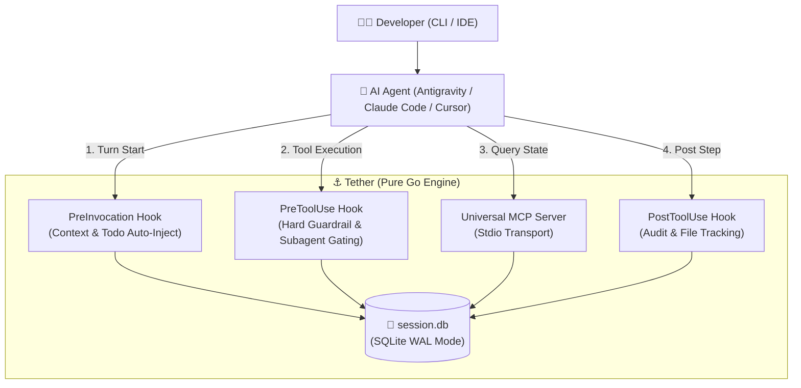

<p align="center">
  
</p>

# ⚓ Tether

<p align="center">
  <strong>The Local-First Deterministic Substrate & Proactive Governance Engine for AI Coding Agents</strong>
</p>

<p align="center">
  <a href="https://github.com/crossparties/tether/releases"></a>
  <a href="https://golang.org"></a>
  <a href="https://sqlite.org"></a>
  <a href="https://modelcontextprotocol.io"></a>
  <a href="LICENSE"></a>
</p>

---

> *"A powerful kite in a storm can only soar stably if anchored to the ground. Cut the string, and it crashes."*  
> **Tether is the deterministic anchor for probabilistic, stochastic AI agents.**

Modern AI agents (Antigravity CLI, Claude Code, Cursor, Codex) suffer from two chronic flaws:
1. **The Amnesiac Agent**: When a session closes, context dies. Architectural decisions, rejected paths, and conventions vanish—forcing endless re-explaining or bloated context-window prompt dumps.
2. **Reckless Mutation**: Stochastic models mutate production code before specifications are validated, or spawn rogue background subagents that hang CLI sessions and silently break repositories.

**Tether** solves this at the operating system level: a lightning-fast, zero-cloud, single-binary substrate embedded directly into your workspace.

---

## ✨ Key Features

- ⚡ **Local-First & Zero-Cloud**: 100% code sovereignty. All sessions, architecture decisions, todos, and learned patterns stay in a local SQLite database (`session.db`). Zero telemetry, zero external cloud dependencies.
- 🛡️ **Hard OS-Level Governance**: Unlike `.cursorrules` or `CLAUDE.md` which models frequently hallucinate past, Tether enforces hard process boundaries (`exit 2`) via lifecycle hooks.
- 🧭 **Spec-Driven Planning Sandboxing**: In **Plan Mode**, file mutations to production code are strictly blocked; only documentation artifacts (`docs/`, `.agents/`) are permitted.
- 🤝 **Subagent Worker-Orchestrator Protocol**: Background subagents are restricted to specialist research and diff proposals. Only the interactive Main Agent can request user approval, completely eliminating hung terminal prompts.
- 🔌 **Universal Model Context Protocol (MCP)**: Built-in stdio MCP server exposing 20+ tools (`session_load`, `sql_query`, `todo_*`, `mode_set`, etc.) pre-approved for frictionless development.
- 🪶 **Blazing Performance**: Pure Go with embedded SQLite running in WAL mode, memory temp store, 10MB cache, and fast-path schema migration (`~70ms` hook latency).

---

## 🏗️ Architecture



---

## 🚀 Quick Start

### 1. Installation

Install Tether using Go:

```bash
go install github.com/crossparties/tether/cmd/tether@latest
```

Or clone and build locally:

```bash
git clone https://github.com/crossparties/tether.git
cd tether
go build -o ~/.local/bin/tether ./cmd/tether
```

### 2. Initialize in a Project

Navigate to your project repository and run:

```bash
tether init
```

This automatically:
- Creates `session.db` with WAL mode enabled.
- Automatically appends `session.db` to `.gitignore`.
- Detects your project's tech stack, package manager, and test runners.

### 3. Wire into Your AI Agent

Tether configures MCP and lifecycle hooks automatically:

```bash
# For Google Antigravity CLI (agy)
tether install agy

# For Anthropic Claude Code
tether install claude

# Verify system health & wiring
tether doctor
```

---

## 🕹️ CLI Usage

```text
tether — The Local-First Deterministic Substrate for AI Agents

Usage:
  tether init              Initialize tether in current project
  tether status            Display real-time substrate dashboard & guardrail state
  tether mode [code|plan]  Inspect or switch active governance mode
  tether doctor            Verify database, WAL, hooks, and agent wiring
  tether mcp               Start MCP server (stdio transport)
  tether hook <event>      Handle lifecycle hook event (PreInvocation|PreToolUse|PostToolUse)
  tether install [agent]   Wire tether into agent config (agy|claude|codex)
  tether version           Show version
```

### Governance Modes

```bash
# Switch to Plan Mode: Codebase writes blocked, only plans allowed
tether mode plan

# Switch to Code Mode: Full implementation unlocked
tether mode code
```

---

## 🧰 Available MCP Tools

When Tether is connected via MCP (`tether mcp`), agents gain access to the following deterministic tools:

| Category | Tool | Description |
| :--- | :--- | :--- |
| **Session** | `workspace_info` | Inspect active project workspace, session ID, branch, and governance mode |
| | `session_load` | Load active or specific session context, settings, and decisions |
| | `session_save` | Save an updated summary of the current session |
| | `session_done` | Mark the active session as completed |
| **Governance** | `mode_get` | Get current governance mode (`plan`, `code`, `review`) |
| | `mode_set` | Switch governance mode |
| | `subagent_spawn_rules` | Retrieve mandatory worker-orchestrator guidelines |
| **Tasks & Todos** | `todo_list` | List pending and completed tasks for current session/branch |
| | `todo_add` | Add a new task item with description |
| | `todo_complete` | Mark a task as completed with optimistic locking |
| | `todo_remove` | Delete a task item |
| **Memory & SQL** | `sql_query` | Execute read/write queries safely against `session.db` |
| | `decision_add` | Record an architectural decision and rationale |
| | `pattern_add` | Record a learned coding pattern (`do` or `avoid`) |
| | `setting_set` | Persist a project-level setting or convention |
| | `files_modified` | Retrieve audit list of files changed in current session |

---

## 🛡️ Subagent Governance Protocol

To prevent recursive loops, token drain, and terminal hangs during background delegation:

1. **Worker Role**: Subagents are strictly specialist workers (researchers, static analyzers, patch generators).
2. **No Direct Mutation**: Subagents cannot write to files or run destructive shell operations.
3. **Interactive Main Gate**: Proposed patches are returned to the Main Agent. The Main Agent presents the proposal to the user in the interactive session for human approval.

---

## 🧪 Testing

Run the comprehensive unit test suite:

```bash
go test -v ./...
```

All core engines, hook handlers, and MCP endpoints run embedded in-memory tests with zero external dependencies.

---

## 📄 License

MIT © [crossparties](https://github.com/crossparties)
