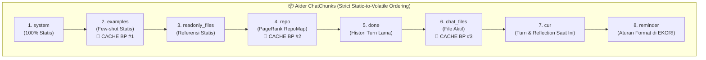

# Analisis Arsitektur Harness Aider & Sintesis Solusi untuk Tether (Tether vs. Aider vs. OpenHands)

> **Repositori Target**: `github.com/crossparties/tether` (`internal/harness`, `internal/mcp`, `internal/core`)  
> **Repositori yang Dianalisis**: `Aider-AI/aider` (`/home/lenovo/crossparties/aider`) & `OpenHands/OpenHands` (`/home/lenovo/crossparties/OpenHands`)  
> **Status Dokumen**: Analisis Arsitektur & Pencarian Solusi (*Analysis & Solution Design Phase — No Code Implementation*)  
> **Metodologi**: Eksplorasi AST, Complexity, dan Simbol Lintas-Repositori secara Maksimal menggunakan MCP (`tree-sitter` & `serena`)

---

## 1. Mengapa Aider Adalah Referensi Terbaik untuk Harness CLI Tether?

Di dalam kode Tether sendiri ([`cmd/tether/main.go:61, 1013`](file:///home/lenovo/crossparties/tether/cmd/tether/main.go#L61) dan [`internal/harness/runner.go:823`](file:///home/lenovo/crossparties/tether/internal/harness/runner.go#L823)), tertulis eksplisit bahwa harness Tether terinspirasi oleh Aider:
> `// RunInteractive starts an Aider/Claude-Code style interactive REPL session`

Jika **OpenHands** adalah referensi terbaik untuk *platform orkestrasi multi-backend/container*, maka **Aider** adalah **referensi emas untuk *lightweight terminal CLI harness*** karena memiliki bentuk faktor (*form factor*) yang identik dengan Tether: berjalan langsung di terminal lokal di atas repositori Git tanpa membutuhkan Docker container.

Melalui analisis MCP `tree-sitter` (`analyze_project`, `get_symbols`, `analyze_complexity`, `find_text`) pada **147 file Python** di `/home/lenovo/crossparties/aider` (terutama [`base_coder.py`](file:///home/lenovo/crossparties/aider/aider/coders/base_coder.py), [`chat_chunks.py`](file:///home/lenovo/crossparties/aider/aider/coders/chat_chunks.py), [`architect_coder.py`](file:///home/lenovo/crossparties/aider/aider/coders/architect_coder.py), [`repomap.py`](file:///home/lenovo/crossparties/aider/aider/repomap.py), [`history.py`](file:///home/lenovo/crossparties/aider/aider/history.py), [`editblock_coder.py`](file:///home/lenovo/crossparties/aider/aider/coders/editblock_coder.py), [`search_replace.py`](file:///home/lenovo/crossparties/aider/aider/coders/search_replace.py), dan [`linter.py`](file:///home/lenovo/crossparties/aider/aider/linter.py)), ditemukan **7 inovasi arsitektur utama di Aider** yang menjawab kelemahan Harness dan Prompt Caching Tether.

---

## 2. Bedah 7 Inovasi Inti Harness Aider & Perbandingannya dengan Tether

### 1. Arsitektur Prompt Berlapis (`ChatChunks`) + *Cache Warming Daemon* vs. Injeksi `messages[0]` Tether
* **Bagaimana Aider Bekerja ([`aider/coders/chat_chunks.py:6-64`](file:///home/lenovo/crossparties/aider/aider/coders/chat_chunks.py#L6-L64) & [`base_coder.py:1226-1394`](file:///home/lenovo/crossparties/aider/aider/coders/base_coder.py#L1226-L1394))**:
  Aider tidak menggabungkan semua konteks ke dalam satu `system` prompt di indeks 0. Sebaliknya, `ChatChunks` membagi prompt menjadi **8 lapisan terurut dari yang Paling Statis (Kepala) ke Paling Volatil (Ekor)**:

  1. **3 Titik Cache Control Eksplisit (`add_cache_control_headers` di `chat_chunks.py:28-55`)**: Menandai `{"cache_control": {"type": "ephemeral"}}` pada akhir `examples/system`, akhir `repo/readonly_files`, dan akhir `chat_files`.
  2. **Reminder Ditaruh di EKOR (`chunks.reminder` / `chunks.cur[-1]`), BUKAN di Kepala (`base_coder.py:1315-1330`)**:
     * Di **Tether**, hook `PreInvocation` menyuntikkan reminder mode (`PLANNING MODE ACTIVE`), `Task Router`, dan `Recent Context` ke dalam **`messages[0]` (Kepala)**, sehingga merusak prefix cache untuk seluruh pesan di belakangnya.
     * Di **Aider**, `chunks.system` (Kepala) **100% statis**, sedangkan `system_reminder` ditempelkan ke **pesan `user` paling terakhir (`chunks.cur[-1]`)**! Dengan cara ini, lapisan 1 s/d 6 (`system` + `examples` + `readonly_files` + `repo` + `done` + `chat_files`) selalu **100% Cache Hit**!
  3. **Active Cache Warming Daemon (`warm_cache` di `base_coder.py:1340-1394`)**:
     * Ephemeral prompt cache di provider LLM umumnya kedaluwarsa setelah 5 menit idle. Aider menjalankan *background thread* (`warm_cache_worker`) yang setiap `295` detik (`5*60 - 5`) mengirim ping `max_tokens: 1` berisi `chunks.cacheable_messages()` agar cache tetap hangat selama developer sedang berpikir atau membaca kode!

---

### 2. Pola `ArchitectCoder` (Dual-Model: *Architect Model* $\rightarrow$ *Editor Model*) vs. `spawn_subagent` Tether
* **Bagaimana Aider Bekerja ([`aider/coders/architect_coder.py:6-48`](file:///home/lenovo/crossparties/aider/aider/coders/architect_coder.py#L6-L48))**:
  Lihat betapa elegan dan ringkasnya implementasi `ArchitectCoder` di Aider (hanya 48 baris kode!):
  1. **Fase 1 — Penalaran Arsitektur (`ArchitectCoder` memakai `main_model`, mis. `deepseek-reasoner` / `o1` / `claude-opus`)**:
     Model Architect fokus 100% menganalisis masalah dan menyusun spesifikasi perubahan kode secara lengkap tanpa dibebani format tool-calling yang rumit.
  2. **Fase 2 — Satu Konfirmasi (`confirm_ask("Edit the files?")`)**:
     Meminta persetujuan user satu kali (atau otomatis jika `auto_accept_architect=True`).
  3. **Fase 3 — Eksekusi Edit Cepat (`editor_coder` memakai `editor_model`, mis. `deepseek-chat` / `claude-sonnet`)**:
     `ArchitectCoder` secara otomatis membuat instance `editor_coder` dengan **`map_tokens=0`**, **`done_messages=[]`**, dan **`cur_messages=[]`**, lalu mengirimkan instruksi dari Architect (`editor_coder.run(with_message=content, preproc=False)`) untuk langsung menerapkan perubahan ke file!
* **Mengapa Ini Jauh Lebih Efektif dari Subagent Tether (`internal/harness/runner.go:528-664`)?**:
  * Di **Tether**, subagent bersifat *read-only*, memakai model yang sama dengan Main Agent, menghasilkan draf diff di chat, mengunci workspace dengan `Proposal`, lalu setelah disetujui user, **Main Agent masih harus membaca ulang file dan memanggil `edit_file` sendiri dari awal (dan meminta approval lagi)**.
  * Dengan pola **Architect $\rightarrow$ Editor Aider**, ketika Tether berada di mode `plan` (atau saat subagent menghasilkan proposal diff), begitu user menyetujui proposal, sebuah **lightweight Editor Runner** (`deepseek-chat`, tanpa overhead 32 tool dan tanpa histori lama) dapat langsung mengeksekusi diff tersebut ke file dalam 1 langkah cepat!

---

### 3. `RepoMap` Berbasis Graph PageRank + Tree-Sitter AST vs. FTS5 `kb_search` Tether
* **Bagaimana Aider Bekerja ([`aider/repomap.py:233-575`](file:///home/lenovo/crossparties/aider/aider/repomap.py#L233-L575) & [`base_coder.py:709-748`](file:///home/lenovo/crossparties/aider/aider/coders/base_coder.py#L709-L748))**:
  1. **Tree-Sitter Tag Extraction + Disk Cache berbasis `mtime` (`get_tags` di `repomap.py:233-264`)**:
     Mengekstrak setiap definisi simbol (`def`: class, function, method, struct) dan referensi simbol (`ref`) menggunakan file kueri Tree-Sitter (`.scm` untuk 100+ bahasa). Hasilnya di-cache berdasarkan `os.path.getmtime(fname)`—jika sebuah file diedit di luar Aider, `mtime` berubah dan file tersebut otomatis di-parse ulang!
  2. **PageRank di Atas Call/Reference Graph (`get_ranked_tags` di `repomap.py:365-574`)**:
     Membangun graf berarah (`nx.MultiDiGraph`) antar file berdasarkan simbol yang didefinisikan di file $A$ dan dipanggil di file $B$. Bobot edge dikalikan secara cerdas:
     * Simbol yang disebut di prompt user (`ident in mentioned_idents`): **$\times 10$**
     * Identifier spesifik (`snake_case` / `camelCase` $\ge 8$ karakter): **$\times 10$**
     * Referensi yang berasal dari file yang sedang aktif di chat (`referencer in chat_rel_fnames`): **$\times 50$**
     * Simbol privat (`_prefix`) atau simbol terlalu umum ($>5$ definisi): **$\times 0.1$**
  3. **Proactive Signature Map dalam Budget Token (`max_map_tokens = 1024`)**:
     Menjalankan algoritma **PageRank** dengan *personalization* ke file yang disebut user, lalu merender *signature* fungsi/kelas terpenting menggunakan `TreeContext` tepat di dalam anggaran 1.024 token.
* **Mengapa Ini Jauh Lebih Efektif dari `kb_search` Tether?**:
  * Di **Tether**, agen memulai setiap tugas dengan "mata tertutup" terhadap struktur kode dan harus membuang 3–5 langkah tool call (`kb_search` / `read_file` / `run_command`) hanya untuk mencari di file mana sebuah fungsi berada. Selain itu, FTS5 Tether (`bootstrapSubstrate` di `runner.go:208`) hanya diindeks sekali saat `TotalFiles == 0` dan tidak memahami relasi pemanggilan fungsi (AST graph).

---

### 4. *Self-Healing Reflection Loop* (`max_reflections = 3`): `"Did you mean?"` + Tree-Sitter AST Linter
* **Bagaimana Aider Bekerja ([`base_coder.py:932-945, 1585-1624`](file:///home/lenovo/crossparties/aider/aider/coders/base_coder.py#L932-L945), [`editblock_coder.py:84-124`](file:///home/lenovo/crossparties/aider/aider/coders/editblock_coder.py#L84-L124), [`search_replace.py:18-327`](file:///home/lenovo/crossparties/aider/aider/coders/search_replace.py#L18-L327), & [`linter.py:82-270`](file:///home/lenovo/crossparties/aider/aider/linter.py#L82-L270))**:
  1. **Multi-Tier Fuzzy Search/Replace + `RelativeIndenter` + Ellipsis `...` (`editblock_coder.py:157-240` & `search_replace.py:18-172`)**:
     Selain pencocokan eksak dan *leading whitespace*, Aider memiliki:
     * `try_dotdotdots`: Mengizinkan model menyingkat bagian tengah blok yang tidak berubah dengan `...` asalkan baris pengapitnya cocok secara unik!
     * `RelativeIndenter`: Mengubah indentasi absolut menjadi indentasi relatif (menggunakan penanda unicode `←` untuk outdent) ditambah Google `diff_match_patch` (`dmp_apply`).
  2. **Refleksi Kegagalan Edit dengan `"Did you mean?"` (`editblock_coder.py:84-124`)**:
     Ketika blok `SEARCH` gagal cocok, Aider **tidak** sekadar menjawab `"target string not found"` seperti Tether (`internal/mcp/server.go:1435`). Aider mencari baris paling mirip di file menggunakan `find_similar_lines` (`difflib.SequenceMatcher`) dan langsung mengirimkan potongan baris asli tersebut kembali ke model:
     > *"Did you mean to match some of these actual lines from {path}?"*
     > Ditambah pengecekan `if updated in content:` (*"The REPLACE lines are already in {path}!"*) serta instruksi agar model hanya mengirim ulang blok yang gagal saja!
  3. **Universal Tree-Sitter AST Syntax Linter (`basic_lint` + `tree_context` di `linter.py:201-269`)**:
     Setiap selesai mengedit file dalam bahasa apa pun, Aider mem-parse AST file tersebut dengan Tree-Sitter, mencari node `ERROR` atau `is_missing`, lalu merender baris yang error (ditandai `█`) beserta konteks fungsi/kelas induknya (`TreeContext`) dan otomatis memasukkannya ke `self.reflected_message` (maksimal `max_reflections = 3`) agar model langsung memperbaiki kesalahannya sendiri!

---

### 5. *Asynchronous Background Recursive Chat Summarizer* (`ChatSummary` dengan `weak_model`)
* **Bagaimana Aider Bekerja ([`aider/history.py:7-124`](file:///home/lenovo/crossparties/aider/aider/history.py#L7-L124) & [`base_coder.py:1002-1046`](file:///home/lenovo/crossparties/aider/aider/coders/base_coder.py#L1002-L1046))**:
  1. **Tidak Pernah Memotong Histori di Tengah Turn**: Selama siklus edit & refleksi (`cur_messages`) berlangsung, `done_messages` tidak pernah diubah.
  2. **Berjalan di Background Thread Setelah Turn Selesai (`summarize_start` di `base_coder.py:1002-1013`)**:
     Hanya setelah turn selesai (`move_back_cur_messages`) dan hanya jika total token `done_messages > max_chat_history_tokens`, Aider menjalankan thread latar belakang `summarize_worker`.
  3. **Algoritma Split Head/Tail Rekursif dengan `weak_model` (`summarize_real` di `history.py:33-96`)**:
     Aider mempertahankan bagian ekor (`tail` sebesar `half_max_tokens`) tetap **100% utuh**, dan hanya meringkas bagian kepala (`head`) yang sudah tua menggunakan `weak_model` yang cepat dan murah!

---

### 6. *Infinite Output Continuation* via Assistant Prefill (`FinishReasonLength`)
* **Bagaimana Aider Bekerja ([`base_coder.py:1492-1505`](file:///home/lenovo/crossparties/aider/aider/coders/base_coder.py#L1492-L1505))**:
  * Ketika respons model terpotong karena mencapai batas `max_tokens` (`finish_reason == "length"`), Aider menangkap `FinishReasonLength`, menaruh teks parsial yang sudah terkumpul ke dalam pesan `assistant` terakhir dengan `prefix=True` (`supports_assistant_prefill` — fitur yang didukung secara native oleh DeepSeek dan Anthropic), lalu otomatis memanggil kelanjutan generasi tanpa membuang token yang sudah dibuat!
  * Di **Tether** (`runner.go:759`), jika `deepseek-chat` melebihi `max_tokens: 4096` saat menulis file besar di `write_file` / `edit_file`, JSON `tool_calls` terpotong di tengah dan gagal total dengan error `invalid tool arguments JSON`.

---

### 7. *Git Hygiene*: Auto-Commit Dirty Human Edits Sebelum AI Menyentuh File
* **Bagaimana Aider Bekerja ([`base_coder.py:2175-2240, 2375-2400`](file:///home/lenovo/crossparties/aider/aider/coders/base_coder.py#L2175-L2240))**:
  * Sebelum mengedit file yang memiliki perubahan manual yang belum di-commit oleh developer (`self.repo.is_dirty(path)`), Aider otomatis mengamankan pekerjaan manusia terlebih dahulu (`check_for_dirty_commit`), baru kemudian menerapkan edit AI. Dengan demikian, perubahan manusia dan perubahan AI tidak pernah tercampur dalam satu diff yang merusak saat di-undo.

---

## 3. Matriks Sintesis 3 Arah: Tether vs. Aider vs. OpenHands

Tabel berikut merangkum posisi arsitektur ketiga sistem dan apa yang harus diambil Tether dari **Aider** maupun **OpenHands**:

| Dimensi Arsitektur | Tether v0.2.0 (Saat Ini) | Aider (Terminal Pair-Programmer) | OpenHands (Agent Canvas & Server) | Solusi Terbaik untuk Diadopsi Tether |
| :--- | :--- | :--- | :--- | :--- |
| **1. Struktur Prompt & Caching** | `messages[0]` ditimpa setiap turn oleh `PreInvocation` + sliding compaction tiap step $\rightarrow$ **Cache Miss Tinggi**. | **`ChatChunks` 8 Lapis** (Static $\rightarrow$ Volatile) + 3 `cache_control` breakpoints + Reminder di **Ekor** + **295s Cache Warming Thread**. | **Immutable `SystemPromptEvent`** saat launch + Append-Only Event Stream hingga `max_size=240`. | **Gabungan Aider + OpenHands**: Bekukan `messages[0]`, gunakan urutan berlapis `ChatChunks`, pindahkan reminder/delta ke **Ekor (`messages[len-1]`)**, dan tambahkan *cache warming*. |
| **2. Kompresi Histori (Compaction)** | `compactMessagesWithLimits` (`keepTurns=2`) memotong tool output `K-2` di setiap step $\rightarrow$ merusak prefix cache. | **`ChatSummary` Background Thread**: Hanya jalan setelah turn selesai jika `> max_tokens`; simpan `tail` 50% utuh, ringkas `head` dengan `weak_model`. | **`LLMSummarizingCondenser`**: Episodik saat event `> 240`, pertahankan `keep_first=2..6` dan `minimum_progress`. | **Episodic + Head/Tail Split**: Jangan pernah memotong di tengah loop tool; kompres hanya saat melewati *High-Water Mark* dengan mempertahankan `keep_first` dan `tail`. |
| **3. Pemetaan Konteks Codebase** | FTS5 `kb_search` pasif (hanya diindeks saat `TotalFiles == 0`, tidak paham struktur AST, butuh tool call manual). | **Proactive `RepoMap`**: Tree-Sitter AST (`def`/`ref`) + cache `mtime` + **Graph PageRank** dalam budget 1.024 token. | Native `glob` + `grep` cepat + `.openhands/memory/` + workspace file tree. | Tambahkan tool native `glob` & `grep` di `internal/mcp`, perbarui indeks FTS5 berbasis `mtime`, dan suntikkan ringkasan *symbol outline* teratas. |
| **4. Mekanisme Edit File & Self-Healing** | `applyFuzzyEdit` 3-tier; jika gagal hanya balas 1 baris `"target string not found"` tanpa konteks baris asli. | **`SEARCH/REPLACE` + `try_dotdotdots` (`...`) + Refleksi `"Did you mean?"` (`SequenceMatcher`)** + cek *"already in file"*. | `file_editor` dengan nomor baris (`Showing lines X-Y of Total`) dan validasi instan. | Tambahkan nomor baris pada semua `read_file`, dukung elipsis `...`, dan kembalikan potongan baris terdekat (*"Did you mean?"*) saat `edit_file` gagal cocok! |
| **5. Verifikasi & Linting Pasca-Edit** | `autoVerifyGo` hardcoded hanya menjalankan `go vet ./...` (timeout 5s) untuk file `.go`. | **Tree-Sitter AST Error Traversal (100+ bahasa)** + `TreeContext` (baris error ditandai `█`) + `max_reflections = 3`. | Configurable Verification & **Critic Iterative Refinement** (`critic_threshold`, `max_refinement_iterations`). | Jalankan verifikasi lintas bahasa berdasarkan `project_settings` di `session.db` dan sertakan cuplikan baris sekitar error secara otomatis. |
| **6. Arsitektur Planning & Subagent** | Subagent read-only $\rightarrow$ tulis teks diff $\rightarrow$ kunci Proposal $\rightarrow$ Main Agent harus edit ulang dari awal + bug `runner.go:642`. | **`ArchitectCoder` Dual-Model**: *Architect Model* (`reasoner`) merancang solusi $\rightarrow$ *Editor Model* (`chat`, `map_tokens=0`) langsung menerapkan edit. | **Dedicated Planner (`.agents_tmp/PLAN.md` $\rightarrow$ 1-Click Build)** + **Isolated Git Worktree Child Conversation**. | Gunakan pola **Architect $\rightarrow$ Editor** saat proposal subagent disetujui (langsung terapkan dengan model Editor cepat tanpa menyuruh Main Agent mengeksplorasi ulang). |
| **7. Penanganan Batas Output (`max_tokens`)** | Jika JSON `tool_calls` melebihi `max_tokens` (4096), request gagal dengan `invalid tool arguments JSON`. | **`FinishReasonLength` + Assistant Prefill (`prefix=True`)**: Otomatis menyambung generasi yang terpotong tanpa kehilangan progres. | Generous output budget + streaming chunk reassembly + retry backoff. | Tangkap `finish_reason == "length"` di `runner.go` / `stream.go` dan lanjutkan dengan DeepSeek Beta Assistant Prefix (`prefix: true`). |
| **8. Keunggulan Unik Tether (The Moat)** | **SQLite WAL Lokal (`session.db`) + OS Hook Exit Code 2 + Single Choke-Point Approval Gate + Cross-Agent Handoff (`agy`/Claude/Cursor)**. | Hanya menyimpan histori di file `.aider.chat.history.md`; tidak menjadi MCP server/hook gatekeeper bagi agen lain. | Berfokus sebagai platform full-stack web/container mandiri. | **Pertahankan 100% Substrat & Guardrail Tether**, lalu perkuat lapisan `internal/harness` dengan 7 teknik Aider + OpenHands di atas! |
