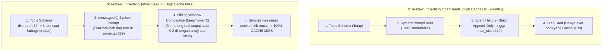

# Dokumentasi Sistem & Panduan Teknis: Tether (v0.2.0)

> **Repositori**: `github.com/crossparties/tether`  
> **Perspektif Dokumen**: Software Analyst & Software Developer Guide

Dokumen ini membedah **Tether (`v0.2.0`)** dari dua sudut pandang terintegrasi:
1. **Software Analyst Perspective**: Analisis masalah & tesis produk, arsitektur dual-layer, spesifikasi fungsional (*Lifecycle Hooks, Proposal Gate, Subagent Governance, Scoped Approval Grants*), skema data SQLite WAL, dan matriks kapabilitas.
2. **Software Developer Perspective**: Peta paket Go (`internal/*`), katalog lengkap **31 MCP Tools**, bedah algoritma & mekanisme keamanan di level kode, serta **daftar invariant & hal krusial yang wajib diperhatikan developer**.

---

## Bagian I: Perspektif Software Analyst (System & Functional Analysis)

### 1. Tesis Produk & Akar Masalah (*Problem Statement*)

Tether dirancang sebagai **Local-First Deterministic Substrate & Proactive Lifecycle Gatekeeper** untuk menjembatani kesenjangan antara sifat **LLM yang probabilistik/stokastik** dan kebutuhan **rekayasa perangkat lunak yang menuntut determinisme absolut**.

| Krisis Agen Otonom | Kegagalan Solusi Konvensional | Solusi Deterministik Tether |
| :--- | :--- | :--- |
| **1. Amnesia Struktural (*The Amnesiac Agent*)** | Sesi berakhir menghapus konteks keputusan arsitektur, histori bug, dan konvensi proyek. Cloud memory (Mem0/Zep) bersifat pasif, lambat (200–1000ms), dan melanggar privasi kode. | **100% Local SQLite WAL Substrate (`session.db`)**: Memori persisten di root proyek dengan latensi kueri `<2ms`, pencarian FTS5 BM25, dan nol data yang keluar dari mesin lokal. |
| **2. Fragmentasi Silo (*The Siloed Agent Paradox*)** | Developer memakai banyak agen (Antigravity `agy`, Claude Code, Cursor, Codex), tetapi masing-masing terisolasi tanpa memori bersama. | **Universal Cognitive Substrate**: Satu state machine, *decision log*, dan *todo graph* bersama yang diakses lintas agen melalui **MCP Stdio Server** dan **Lifecycle Hooks**. |
| **3. Mutasi Kode Prematur (*Reckless Coding*)** | Aturan berbasis prompt (`.cursorrules`, `CLAUDE.md`) hanyalah "imbauan moral" yang dilupakan model saat *context window* membesar (*attention drift*). | **Hard OS/Tool Boundary Enforcement**: Intersepsi di level proses (`exit code 2`) dan *single choke-point approval gate* yang secara fisik memblokir mutasi disk saat mode `plan` atau saat proposal subagent belum disetujui. |

---

### 2. Pemodelan Alur Tata Kelola (*Governance & Security Flows*)

#### A. Pipeline Intersepsi 5 Lapis pada `PreToolUse` (`tether hook PreToolUse`)
Setiap kali agen hendak mengeksekusi tool, `handlePreToolUse` di [`internal/hooks/handler.go`](file:///home/lenovo/crossparties/tether/internal/hooks/handler.go#L335-L515) menjalankan pemeriksaan berlapis:

```mermaid
flowchart TD
    Start["PreToolUse Hook Input (Tool, Args, ConversationID)"] --> L1{"1. Catastrophic & DB Hack Check\n(dangerous.go)"}
    L1 -->|rm -rf /, mkfs, dd, shred,\natau akses bash langsung ke session.db| Deny1["DENY (Exit Code 2)"]
    L1 -->|Aman| RoleCheck{"Apakah Subagent?\n(ConversationID != main_conversation_id)"}

    RoleCheck -->|Ya: Subagent| L2{"2. Subagent Allowlist Gate\n(subagent_access.go)"}
    L2 -->|Unwrap MCP Wrapper -> Cek Allowlist:\nHanya Read Tools, Read-Only SQL,\ngit diff/status/log/show, & go test/build/vet| AllowSub["ALLOW"]
    L2 -->|Write tool, mutative SQL,\ngit add/commit/reset/stash, atau tool asing| DenySub["DENY (Exit Code 2)\nWajib kirim Proposal ke Main Agent"]

    RoleCheck -->|Tidak: Main Agent| L3{"3. Pending Proposal Gate\n(Ada proposal subagent pending?)"}
    L3 -->|Ya & tool bersifat mutatif\n(write files, state tools, mutative SQL/bash)| DenyProp["DENY (Exit Code 2)\nWajib approve_proposal / reject_proposal dulu"]
    L3 -->|Tidak ada pending / tool adalah approve/reject| L4{"4. Plan Mode Gate\n(Mode == 'plan'?)"}

    L4 -->|Ya & Write di luar docs/**, .agents/**, *.plan.md\natau mutative shell command| DenyPlan["DENY (Exit Code 2)\nLocked in PLAN MODE"]
    L4 -->|Mode == 'code' atau tulis di docs/**| L5["5. Capture Pre-Write Snapshot\n(.tether/snapshots) & ALLOW"]
```

#### B. Siklus Hidup Proposal Subagent (*Enforceable Proposal Gate*)
1. **Isolasi Subagent**: Subagent dijalankan sebagai *specialist worker* (`tether_planner`, `tether_coder`, `tether_reviewer`, `tether_qa`, `tether_researcher`, `worker`). Subagent tidak bisa memodifikasi file atau membuat commit Git (`git add`/`git commit` ditolak mutlak).
2. **Structured Handoff (`core.ParseHandoff`)**: Output subagent wajib memuat blok status terstruktur (`STATUS: READY_FOR_REVIEW | BLOCKED | NEEDS_CONTEXT` atau `VERDICT: APPROVED | REJECTED` beserta `REMEDIATION`). Jika output berupa prosa bebas tanpa blok status, `runSubagent` melakukan *re-dispatch* satu kali sebelum menggagalkan tugas (*fail-closed*).
3. **Kunci Mutasi Global Saat Proposal Pending**: Begitu proposal subagent tercatat dengan status `pending` di tabel `subagent_proposals`, **Main Agent otomatis terkunci** dari melakukan mutasi file maupun state sampai pengguna menyetujui atau menolak proposal tersebut (baik lewat chat `approve_proposal` / `reject_proposal` maupun secara *out-of-band* lewat CLI `tether proposal approve <id>` / `tether proposal reject <id> -m "arahan"`).

#### C. Single Choke-Point Approval Gate & Scoped Grants
Di dalam [`internal/mcp/server.go`](file:///home/lenovo/crossparties/tether/internal/mcp/server.go#L615-L693) dan [`internal/mcp/approval.go`](file:///home/lenovo/crossparties/tether/internal/mcp/approval.go#L129-L191):
* Semua tool mutasi yang dipanggil via MCP melewati `Server.CallTool` $\rightarrow$ `s.requireApproval(name, args)`.
* **Path Grant vs. Command Grant Terpisah**:
  * Izin tulis file (`VerdictFolder`) disimpan per-direktori dan diverifikasi menggunakan resolusi symlink (`scopeCoversPath`).
  * Izin perintah shell disimpan dengan prefix `cmd:` atau `cmdprefix:`. Fungsi `CommandPrefix` secara cerdas memperluas prefix menjadi **2 kata** untuk binary bersubcommand (`git`, `go`, `npm`, `pnpm`, `yarn`, `cargo`, `docker`, `kubectl`, `tether`) dan **1 kata** untuk binary argumen posisional (`echo`, `cat`).
  * Seluruh grant memiliki **TTL 60 menit** (`DefaultGrantTTLMinutes = 60`).

---

## Bagian II: Perspektif Software Developer (Technical Architecture & Codebase Guide)

### 1. Peta Paket & Tanggung Jawab Kode (`internal/*`)

| Paket | File Utama | Tanggung Jawab Teknis |
| :--- | :--- | :--- |
| `cmd/tether` | [`main.go`](file:///home/lenovo/crossparties/tether/cmd/tether/main.go) | Entrypoint CLI, subcommand routing, dan konstruksi `tui.AgentBridge`. |
| `internal/core` | [`engine.go`](file:///home/lenovo/crossparties/tether/internal/core/engine.go), [`grants.go`](file:///home/lenovo/crossparties/tether/internal/core/grants.go), [`handoff.go`](file:///home/lenovo/crossparties/tether/internal/core/handoff.go), [`workspace.go`](file:///home/lenovo/crossparties/tether/internal/core/workspace.go) | Koneksi SQLite WAL (`modernc.org/sqlite`), migrasi skema v2, manajemen sesi, proposal, approval grants, FTS5 BM25 indexer, dan parser handoff subagent. |
| `internal/mcp` | [`server.go`](file:///home/lenovo/crossparties/tether/internal/mcp/server.go), [`approval.go`](file:///home/lenovo/crossparties/tether/internal/mcp/approval.go) | Server JSON-RPC 2.0 stdio, implementasi 31 tool MCP, *fuzzy whitespace-tolerant edit* (`applyFuzzyEdit`), auto `go vet`, dan *approval gate*. |
| `internal/hooks` | [`handler.go`](file:///home/lenovo/crossparties/tether/internal/hooks/handler.go), [`dangerous.go`](file:///home/lenovo/crossparties/tether/internal/hooks/dangerous.go), [`subagent_access.go`](file:///home/lenovo/crossparties/tether/internal/hooks/subagent_access.go) | Handler `PreInvocation`, `PreToolUse`, `PostToolUse`; AST/token classifier untuk perintah shell berbahaya; allowlist subagent; dan *Proposal Gate*. |
| `internal/safety` | [`policy.go`](file:///home/lenovo/crossparties/tether/internal/safety/policy.go), [`shell.go`](file:///home/lenovo/crossparties/tether/internal/safety/shell.go) | Klasifikasi risiko (`RiskLow` vs `RiskHigh`), deteksi perintah baca/validasi, resolusi symlink workspace, dan kebijakan `IsNonCriticalTool`. |
| `internal/snapshot` | [`snapshot.go`](file:///home/lenovo/crossparties/tether/internal/snapshot/snapshot.go) | Backup file sebelum penulisan ke `.tether/snapshots/<turn>/` dan pemulihan `tether undo`. |
| `internal/preview` | [`preview.go`](file:///home/lenovo/crossparties/tether/internal/preview/preview.go) | Pembuat unified diff berwarna untuk pratinjau persetujuan. |
| `internal/harness` | [`runner.go`](file:///home/lenovo/crossparties/tether/internal/harness/runner.go), [`commands.go`](file:///home/lenovo/crossparties/tether/internal/harness/commands.go), [`subagent.go`](file:///home/lenovo/crossparties/tether/internal/harness/subagent.go), [`btw.go`](file:///home/lenovo/crossparties/tether/internal/harness/btw.go), [`stream.go`](file:///home/lenovo/crossparties/tether/internal/harness/stream.go) | Loop eksekusi LLM multi-provider, registri slash command, *turn-aware context compaction*, `/btw` side-chat terisolasi, dan runner subagent. |
| `internal/orchestrator` | [`engine.go`](file:///home/lenovo/crossparties/tether/internal/orchestrator/engine.go), [`worker.go`](file:///home/lenovo/crossparties/tether/internal/orchestrator/worker.go), [`registry.go`](file:///home/lenovo/crossparties/tether/internal/orchestrator/registry.go) |Manajemen worker goroutine konkuren dan kanal sinkronisasi persetujuan TUI. |
| `internal/tui` | [`model.go`](file:///home/lenovo/crossparties/tether/internal/tui/model.go), [`update.go`](file:///home/lenovo/crossparties/tether/internal/tui/update.go), [`view.go`](file:///home/lenovo/crossparties/tether/internal/tui/view.go), [`program.go`](file:///home/lenovo/crossparties/tether/internal/tui/program.go) | Full-screen Terminal UI (Model-Update-View) dengan modal persetujuan, dropdown autocomplete, dan monitor subagent. |
| `internal/ui` | [`ui.go`](file:///home/lenovo/crossparties/tether/internal/ui/ui.go), [`picker.go`](file:///home/lenovo/crossparties/tether/internal/ui/picker.go), [`spinner.go`](file:///home/lenovo/crossparties/tether/internal/ui/spinner.go), `termios_*.go` | Utilitas warna ANSI, kalkulasi lebar karakter Unicode/CJK, spinner, dan raw-mode `termios`. |
| `internal/adapter` | [`adapter.go`](file:///home/lenovo/crossparties/tether/internal/adapter/adapter.go) | Installer konfigurasi agen (`tether install agy|claude|codex|cursor|windsurf|cline|roo|opencode|all`). |

---

### 2. Hal-Hal Krusial yang Wajib Diperhatikan Developer (*Developer Guardrails & Invariants*)

#### 1. Kepatuhan Pure-Go Zero-CGO (`CGO_ENABLED=0`)
> [!IMPORTANT]
> Tether harus selalu dapat dikompilasi menjadi satu static binary tanpa ketergantungan C (`libc`). Selalu gunakan `modernc.org/sqlite` dan syscall `termios` murni; jangan menambahkan paket yang membutuhkan CGO.

#### 2. Stabilitas Prefix 64-Token untuk Context Caching LLM
Pada `handlePreInvocation` di [`internal/hooks/handler.go`](file:///home/lenovo/crossparties/tether/internal/hooks/handler.go#L211-L260):
* Jaga agar header protokol dan `project_settings` (diurutkan dengan `sort.Strings(keys)`) selalu berada di bagian paling atas string konteks yang diinjeksikan.
* **Wajib melewati (`continue`) key `current_turn`** saat mencetak `project_settings`. Jika timestamp `current_turn` ikut dicetak di bagian atas prompt, *64-token prefix cache* pada provider seperti DeepSeek akan hangus di setiap turn.

#### 3. Jangan Memblokir `approve_proposal` & `reject_proposal` di Proposal Gate
Pada `handlePreToolUse` di [`internal/hooks/handler.go`](file:///home/lenovo/crossparties/tether/internal/hooks/handler.go#L368-L387):
* `approve_proposal` dan `reject_proposal` sengaja **tidak dimasukkan** ke dalam map `stateTools`. Memasukkan keduanya ke dalam daftar tool yang diblokir saat ada proposal `pending` akan menciptakan *permanent deadlock* karena agen tidak lagi bisa menyelesaikan proposal yang sedang menunggu tersebut.

#### 4. Wajib Unwrap MCP Wrapper sebelum Mengecek Allowlist Subagent
Pada `checkSubagentAccess` di [`internal/hooks/subagent_access.go`](file:///home/lenovo/crossparties/tether/internal/hooks/subagent_access.go#L114-L160):
* Selalu panggil `subagentUnwrapMCP(toolName, args)` di baris pertama sebelum memeriksa `subagentReadTools` atau `sql_query`. Tanpa langkah ini, panggilan berbungkus seperti `call_mcp_tool(sql_query, "DELETE FROM ...")` dapat mengecoh pengecekan nama tool luar.

#### 5. Resolusi Symlink sebelum Validasi Path (`EvalSymlinks`)
Pada `resolvePath` ([`internal/mcp/server.go`](file:///home/lenovo/crossparties/tether/internal/mcp/server.go#L1050-L1070)), `resolveWithinWorkspace` ([`internal/safety/policy.go`](file:///home/lenovo/crossparties/tether/internal/safety/policy.go)), dan `scopeCoversPath` ([`internal/core/grants.go`](file:///home/lenovo/crossparties/tether/internal/core/grants.go)):
* Selalu evaluasi symlink menggunakan `evalSymlinksWithAncestor` / `filepath.EvalSymlinks` sebelum memeriksa apakah sebuah path berada di dalam workspace, di dalam `docs/`, atau tercakup oleh *Approval Grant*. Ini mencegah *symlink traversal escape*.

#### 6. Isolasi Mutlak pada `/btw` Side-Chat
Pada `RunSideChat` ([`internal/harness/btw.go`](file:///home/lenovo/crossparties/tether/internal/harness/btw.go)):
* `/btw` tidak boleh memodifikasi slice `r.messages` milik sesi utama, tidak boleh mengeksekusi tool mutasi, dan tidak boleh menulis entri baru ke `session_context` di `session.db`. Pastikan `btw_isolation_test.go` selalu lulus.

#### 7. Sinkronisasi Tabel Slash Command (`registry_tripwire_test.go`)
* Setiap penambahan atau perubahan slash command di [`internal/harness/commands.go`](file:///home/lenovo/crossparties/tether/internal/harness/commands.go) harus sinkron dengan `DefaultSlashCommands()` di [`internal/tui/model.go`](file:///home/lenovo/crossparties/tether/internal/tui/model.go) dan diverifikasi dengan `go test ./internal/harness/...`.

#### 8. Catatan Nama Modul di `go.mod`
> [!NOTE]
> Nama organisasi resmi proyek ini adalah **`crossparties`** (`github.com/crossparties/tether`). Di level kode Go saat ini, [`go.mod`](file:///home/lenovo/crossparties/tether/go.mod#L1) masih tertulis `module github.com/croosparties/tether`. Selama belum dilakukan refactor import serentak di file `.go`, jangan mencampur import `crossparties` dan `croosparties` di dalam file `.go` agar `go build ./...` tetap kompilabel.

---

### 3. Analisis Mendalam: Mengapa Prompt Caching Tether Meleset Jauh Dibanding OpenHands?

> [!TIP]
> **Blueprint Lengkap & Studi Solusi (OpenHands & Aider):**
> - [PROMPT_CACHING_WEAKNESS_AND_OPENHANDS_SOLUTION.md](./PROMPT_CACHING_WEAKNESS_AND_OPENHANDS_SOLUTION.md) — Bedah 5 kelemahan Prompt Caching Tether vs Episodic Condenser OpenHands.
> - [HARNESS_WEAKNESS_AND_OPENHANDS_COMPARISON.md](./HARNESS_WEAKNESS_AND_OPENHANDS_COMPARISON.md) — Bedah 8 kelemahan Harness Tether (`internal/harness`) vs efektivitas Agent Harness OpenHands.
> - [AIDER_HARNESS_ANALYSIS_AND_TETHER_SOLUTIONS.md](./AIDER_HARNESS_ANALYSIS_AND_TETHER_SOLUTIONS.md) — Bedah 7 inovasi CLI Harness Aider (`ChatChunks`, `ArchitectCoder`, `RepoMap` PageRank, `"Did you mean?"` Reflection Loop, `ChatSummary`, Assistant Prefill) & sintesis 3 arah.
> - [THREE_WAY_UNIQUENESS_ANALYSIS.md](./THREE_WAY_UNIQUENESS_ANALYSIS.md) — Analisis komparatif keunikan eksklusif (*The Moat*) dari ketiga sistem: **OpenHands vs. Aider vs. Tether**.
> - [DOCKER_FREE_OPENHANDS_AIDER_FILE_MOUNTING_BLUEPRINT.md](./DOCKER_FREE_OPENHANDS_AIDER_FILE_MOUNTING_BLUEPRINT.md) — **Master Blueprint Arsitektur Tether v0.3.0**: Mengadopsi 100% kapabilitas efektif OpenHands tanpa sistem Docker (*Zero-Docker Local & Git-Worktree Runtime*) + Sistem Per-File Mounting 4-Tier (`/add`, `/readonly`, `/drop`, `/deny`, `/files`, `/tokens`) dari Aider yang ditegakkan secara deterministik di gerbang keamanan OS/MCP Tether.

Observasi bahwa **Prompt Caching di OpenHands jauh lebih optimal sedangkan di Tether jumlah *cache miss*-nya sangat tinggi** adalah **100% akurat secara matematis dan arsitektural**.

Pada seluruh engine LLM modern (DeepSeek 64-token block cache, OpenAI, Anthropic, Gemini), **KV-Cache bekerja secara *Strict Left-to-Right Prefix Matching***:
$$\text{Prefix Sequence} = \underbrace{\text{Tools Schema}}_{\text{Blok Awal}} \rightarrow \underbrace{\text{messages}[0] (\text{System})}_{\text{Blok Kedua}} \rightarrow \underbrace{\text{messages}[1]}_{\text{Turn 1}} \rightarrow \dots \rightarrow \underbrace{\text{messages}[N]}_{\text{Turn } N}$$

> [!CAUTION]
> **Hukum Mutlak Prefix Cache:** Begitu ada **1 token saja berubah pada posisi $K$**, maka **seluruh token setelah posisi $K$ ($K+1 \dots N$) mengalami 100% CACHE MISS**, meskipun isi `messages[K+1..N]` tidak berubah sama sekali!

Berikut adalah **4 akar masalah di kode Tether** yang merusak *prefix cache* dibanding desain **Append-Only + Episodic Condenser** milik OpenHands:



#### Akar Masalah 1: Mutasi Ekor `messages[0]` (System Prompt) di Setiap Turn Baru ([`runner.go:329`](file:///home/lenovo/crossparties/tether/internal/harness/runner.go#L312-L330) & [`handler.go:263-325`](file:///home/lenovo/crossparties/tether/internal/hooks/handler.go#L263-L325))
* **Apa yang terjadi di Tether**: Pada setiap awal `Runner.Run()`, Tether memanggil `PreInvocation` lalu menimpa `messages[0]` (`messages[0] = chatMessage{Role: "system", Content: sysPrompt}`).
* Meskipun bagian atas `PreInvocation` sudah diurutkan (`Project Settings`), bagian ekor `PreInvocation` menyuntikkan **`Recent Session Context`** (6 pesan terakhir yang **pasti berubah** setelah setiap turn), **`Todos`** (berubah saat todo ditambah/diselesaikan), dan **`Task Router`** (berubah sesuai klasifikasi prompt baru).
* **Ilusi di [`deepseek_opt_test.go:46-62`](file:///home/lenovo/crossparties/tether/internal/harness/deepseek_opt_test.go#L46-L62)**: Unit test tersebut menganggap stabilitas 85% di dalam `messages[0]` sudah bagus. Padahal, karena **15% ekor `messages[0]` berubah**, perubahan itu terjadi di **Index 0** dari array `messages`! Akibatnya, seluruh histori percakapan di belakangnya (`messages[1]`, `messages[2]`, $\dots$, `messages[N]` yang berisi ribuan token kode dan diskusi) mengalami **100% Cache Miss** setiap ganti turn!
* **Mengapa OpenHands Lebih Optimal**: Di OpenHands ([`F15-agent-behavior-settings.md`](file:///home/lenovo/crossparties/OpenHands/.agents/skills/verify-openhands/references/feature-map/F15-agent-behavior-settings.md#L93)), `SystemPromptEvent` dibuat **satu kali** saat percakapan dimulai dan tidak pernah dimodifikasi lagi di tengah percakapan.

#### Akar Masalah 2: *Sliding-Window Compaction* (`keepTurns = 2`) di Setiap Step Tool Loop ([`runner.go:384`](file:///home/lenovo/crossparties/tether/internal/harness/runner.go#L382-L386) & [`runner.go:918-971`](file:///home/lenovo/crossparties/tether/internal/harness/runner.go#L918-L971))
* **Apa yang terjadi di Tether**: Di dalam loop `for step := 0; step < r.cfg.MaxSteps; step++`, Tether memanggil `messages = compactMessagesWithLimits(messages, keepTurns, maxRunes)` dengan `keepTurns = 2` **sebelum setiap panggilan `callAPI`**.
* Bayangkan agen menjalankan 6 langkah tool call berurutan (`read_file` atau `kb_search` yang menghasilkan >800 rune):
  * **Step 1 & 2**: Semua tool output masih utuh.
  * **Step 3**: `turnsSeen` mencapai 2. `cutoff` bergeser maju, lalu `compactMessagesWithLimits` **mengubah isi `messages[3]` (tool output dari Step 1)** di tengah array menjadi `"... [compacted N chars ...]"`! Karena `messages[3]` berubah, **seluruh token Step 2 dan Step 3 (ribuan token terbesar yang justru masih utuh!) gagal masuk cache (Cache Miss)!**
  * **Step 4**: `cutoff` bergeser maju 1 langkah lagi, **mengubah isi `messages[5]` (tool output dari Step 2)**! Akibatnya, seluruh token Step 3 dan Step 4 kembali **Cache Miss**!
  * **Step 5**: `cutoff` bergeser maju lagi, **mengubah isi `messages[7]` (tool output dari Step 3)**! Seluruh token Step 4 dan Step 5 kembali **Cache Miss**!
* **Mengapa OpenHands Lebih Optimal**: OpenHands menggunakan **Episodic / Amortized Condenser** (`max_size = 240` events, `keep_first = 2`). Selama belum menyentuh 240 event, OpenHands **tidak pernah menyentuh atau memotong pesan lama di tengah array** (*strictly append-only*). Hasilnya, pada Step 3, 4, 5, ..., 50 di OpenHands, seluruh pesan sebelumnya **100% Cache Hit**, dan yang menjadi *cache miss* hanyalah 1 pesan `tool` baru di paling ujung!

#### Akar Masalah 3: Pemangkasan Daftar `tools` pada Subagent Menghanguskan Cache Prefix Utama ([`runner.go:339-360`](file:///home/lenovo/crossparties/tether/internal/harness/runner.go#L339-L360))
* **Apa yang terjadi di Tether**: Main Agent mengirimkan 32 definisi tool di field `payload["tools"]`, sedangkan Subagent menyaring `payload["tools"]` menjadi hanya 6 tool dan mengganti `messages[0]` dengan prompt subagent.
* Karena LLM memproses `tools` di posisi paling awal sebelum `messages[0]`, perbedaan jumlah/urutan `tools` antara Main Agent dan Subagent membuat **Subagent selalu memulai dengan 0% Cache Hit** (tidak bisa menumpang cache `tools` + `system prompt` milik Main Agent).

#### Akar Masalah 4: Pembersihan `ReasoningContent` & Compaction Saat Transisi Turn ([`runner.go:331-335`](file:///home/lenovo/crossparties/tether/internal/harness/runner.go#L331-L335))
* Selama sebuah turn multi-step berlangsung, `ReasoningContent` dipertahankan pada pesan `assistant`. Begitu turn berikutnya dimulai, loop di baris 331 menghapus `ReasoningContent` dari pesan `assistant` pada turn sebelumnya. Penghapusan field yang sebelumnya ikut terkirim di JSON otomatis mengubah urutan token mulai dari pesan `assistant` tersebut ke bawah.

---

#### Rekomendasi Solusi Arsitektural untuk Memperbaiki Prompt Caching Tether

Jika ke depan Anda ingin memperbaiki *cache hit rate* Tether agar setara dengan OpenHands:
1. **Bekukan `messages[0]` (Immutable System Prompt)**:
   * Jangan pernah menimpa `messages[0]` setelah turn pertama dimulai.
   * Jika ada perubahan state dinamis (seperti todo baru, decision baru, atau perubahan mode `plan`/`code`), suntikkan sebagai *ephemeral reminder* kecil di ujung pesan `user` terbaru (di ekor array `messages[len-1]`), **bukan** dengan mengubah `messages[0]` di kepala array!
2. **Ganti *Per-Step Sliding Compaction* menjadi *Threshold-Based Amortized Compaction* (Gaya Condenser OpenHands)**:
   * Jangan mengompresi `tool` output lama pada setiap step (`keepTurns = 2`). Biarkan `messages` bersifat **100% append-only** selama total ukuran konteks masih di bawah ambang batas (misalnya `< 32.000` karakter / `~8.000` token, atau setiap kelipatan 12 step).
   * Saat ambang batas tercapai, kompres seluruh step lama sekaligus dalam satu kali operasi (*amortized compaction*), sehingga 11 step berikutnya kembali menikmati **~95% cache hit**!
3. **Pertahankan Prefix `tools` + `messages[0]` pada Subagent (Opsional)**:
   * Jika subagent menggunakan daftar `tools` dan `messages[0]` dasar yang sama dengan Main Agent (sementara pembatasan role subagent ditaruh di `messages[1]` dan tetap dijaga secara fisik oleh `PreToolUse` `checkSubagentAccess`), maka panggilan pertama subagent akan langsung mendapatkan **100% Cache Hit** pada blok `tools` + `messages[0]` (~2.000+ token gratis dari cache Main Agent).

---

### 4. Perintah Verifikasi & Diagnostik

```bash
# Menjalankan seluruh test suite (12 paket)
go test ./...

# Pemeriksaan analisis statis Go
go vet ./...

# Build binary tether
go build -o tether ./cmd/tether

# Menjalankan diagnostik integritas database, WAL, .gitignore, dan wiring agen
./tether doctor

# Menampilkan dashboard status workspace, mode, FTS5 KB, todo, dan pending proposal
./tether status
```
