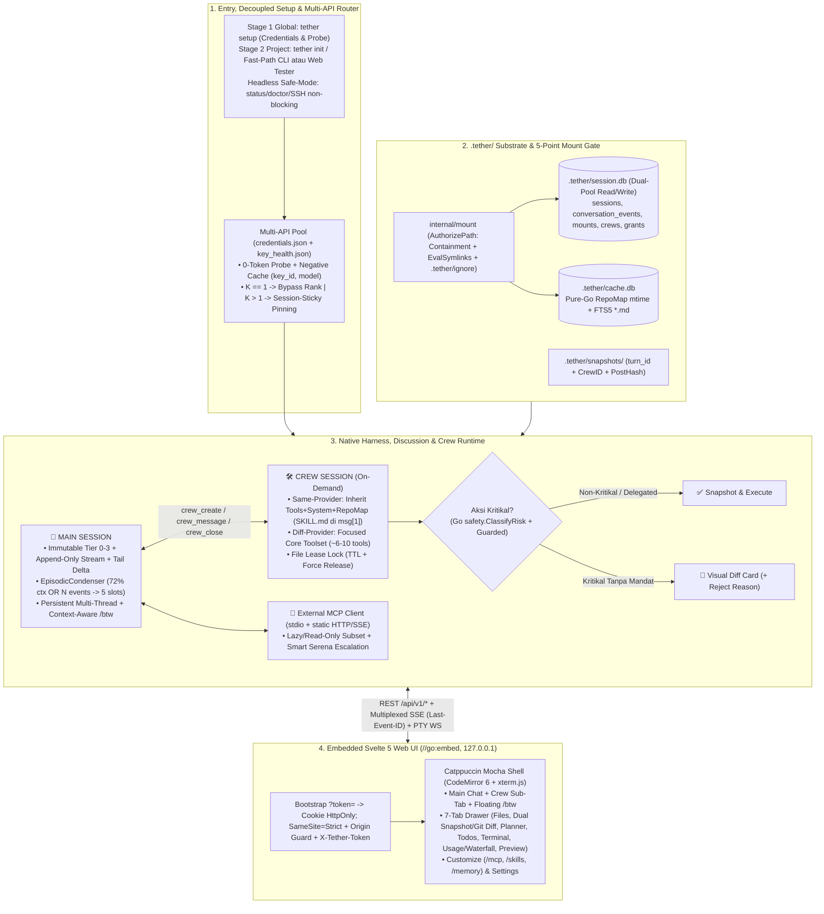

# Master Rancangan Pengembangan Tether v0.3.0: Zero-Docker OpenHands (Svelte 5 Web UI) + Aider Context/RepoMap + Crew Session + Multi-API Pool + `.tether/` Substrate

> **Status Dokumen**: **Finalized & Audited Development Blueprint (Opsi C — Siap Eksekusi Fase 1)**  
> **Pembaruan Terakhir**: 2026-11-23 (Hasil Audit Lintas-Skill & MCP `serena`/`tree-sitter`)  
> **Target Repositori**: `github.com/crossparties/tether` (`/home/lenovo/crossparties/tether`)  
> **Dokumen Referensi**: [`STATUS.md`](./STATUS.md), [`DEVELOPER_AND_ANALYST_GUIDE.md`](./DEVELOPER_AND_ANALYST_GUIDE.md), [`AIDER_HARNESS_ANALYSIS_AND_TETHER_SOLUTIONS.md`](./AIDER_HARNESS_ANALYSIS_AND_TETHER_SOLUTIONS.md), [`PROMPT_CACHING_WEAKNESS_AND_OPENHANDS_SOLUTION.md`](./PROMPT_CACHING_WEAKNESS_AND_OPENHANDS_SOLUTION.md), [`THREE_WAY_UNIQUENESS_ANALYSIS.md`](./THREE_WAY_UNIQUENESS_ANALYSIS.md)

---

## 1. Arah Produk & 7 Keputusan Arsitektur Final (Opsi C)

Tether v0.3.0 mengadopsi **Opsi C**: berevolusi menjadi **Full-Stack Local Autonomous Engineering Platform** (*Zero-Docker OpenHands + Aider Harness + Tether Deterministic Substrate*) dalam satu static binary Pure Go (`CGO_ENABLED=0`) + embedded Svelte 5 Web UI (`//go:embed`).

| No | Keputusan Final | Detail & Rasional Arsitektural |
| :-: | :--- | :--- |
| **1** | **Zero-Docker Native Runtime & Pending Server IDE Eksternal** | • Seluruh kemampuan eksekusi dijalankan **100% native di OS lokal** oleh binary Go Tether (0 container boot delay, 0 overhead Docker/Node saat runtime).<br>• Peran Tether *sebagai MCP Server eksternal* (`tether mcp` serve, `tether hook`, `internal/adapter`) ditandai **`[Deferred / Legacy Bridge]`** selama Fase 1–6 agar pengembangan fokus pada satu jalur in-process tanpa *dual-maintenance*. |
| **2** | **Konsolidasi Total ke `.tether/` + SQLite Dual-Pool (`cache.db`)** | • Semua file per-project milik Tether dirapikan di dalam `<root>/.tether/` (`session.db*`, `cache.db*`, `snapshots/`, `PLAN.md`, `mcp.json`, `ignore`) — **nol file berceceran di root**.<br>• Pisahkan `session.db` (state berharga) dari `cache.db` (FTS5 dokumen + Pure-Go `RepoMap` `mtime` tags), dengan **Dual-Pool (`writeDB` `MaxOpenConns=1` + `readDB` `MaxOpenConns=4..8` `query_only=ON`)**, batch transactions, dan secondary indexes. |
| **3** | **Hapus Subagent Lama $\rightarrow$ `Crew Session` Berbasis Chat + `SKILL.md`** | • **Dihapus total**: `internal/harness/subagent*.go`, `internal/hooks/subagent_access.go`, `internal/core/handoff.go`, `internal/orchestrator/`, `internal/tui/subagents.go`, `pending_proposals`, `cmdProposal`, dan 4 tool proposal lama.<br>• **Penggantinya (`Crew Session`)**: Chat session terisolasi (`parent_session_id`) berbasis `Runner` yang sama, dikendalikan 2 arah oleh `Main Session` (`crew_create`, `crew_message`, `crew_close`), dilindungi *File Ownership Lease Lock*, serta memiliki 2 mode toolset (*Same-Provider* berbagi KV-cache vs *Different-Provider* ringkas). |
| **4** | **`.gitignore`-Style Mounting (`.tether/ignore`) + 5-Point Security** | • Format default **`.gitignore` glob** yang ramah manusia + prefiks opsional `re:` untuk regex penuh (fallback membaca `.tetherignore` di root bila ada).<br>• Satu fungsi `mountEngine.AuthorizePath(path, OpRead\|OpWrite)` menegakkan *Abs/Rel containment* + `evalSymlinksWithAncestor` + ignore rules **baik untuk operasi baca maupun tulis** di 5 titik (menutup celah read-path saat ini di `toolReadFile` & `IsNonCriticalTool`). |
| **5** | **KV-Cache Append-Only, Pure-Go `RepoMap` & Diskusi Persisten** | • `Tier 0–3` (`tools`, immutable `System`, static RO, `Baseline RepoMap` ~800–1.024 token) dibekukan di kepala; stream `done + cur` **100% append-only** (**tanpa** slot `chat_files` tengah ala Aider); delta & `Focused Delta RepoMap` hanya di **tail**.<br>• `EpisodicCondenser` memakai **dual-threshold (`estimated_tokens >= 0.72 * context_window OR event_count >= max_events`)** + ringkasan 5-slot.<br>• Sistem diskusi ditingkatkan: multi-thread persisten (`conversation_events`), `/btw` context-aware + read-only tools + isolasi `usage_id`, serta kartu klarifikasi `Plan`/`Architect`. |
| **6** | **Multi-API Key Pool, *Session-Sticky* & `Canonical Sanitizer`** | • Secret key disimpan **hanya** di `~/.config/tether/credentials.json` (`0600`, multi-key array per provider) — tidak pernah di `session.db`.<br>• Startup `0-token probe` + **Negative Capability Cache `(key_id, model)`**, bypass ranking saat `K == 1`, **Session-Sticky Key Pinning** (tidak pindah provider karena selisih kecil TTFT), dan `Canonical Message Sanitizer` 1-to-1 saat failover mid-stream. |
| **7** | **External MCP Client (CLI + Web) & Svelte 5 `//go:embed` UI** | • Tether dapat mengonsumsi server MCP eksternal (`stdio` + static-auth `HTTP/SSE`) lewat CLI `tether mcp add\|import\|list\|test\|enable\|disable\|remove` dan Web `/mcp`, dengan **Smart `serena` Escalation** (Lazy + Read-Only Semantic mode untuk repo besar/refaktor lintas-file).<br>• Web UI Svelte 5 memakai Design System **Catppuccin Mocha** (sinkron 1-to-1 dengan `internal/tui/styles.go`), **CodeMirror 6 + `xterm.js`** (tanpa Monaco), dan cookie bootstrap `HttpOnly; SameSite=Strict` + `Origin` check. |

---

## 2. Arsitektur Sistem & Tata Letak Direktori `.tether/`

### 2.1 Struktur Direktori Rapi (Per-Project & Global)

```text
<project-root>/
├── .gitignore                      # Minimal mengabaikan runtime Tether:
│                                   # .tether/session.db*, .tether/cache.db*, .tether/snapshots/, .tether/PLAN.md
│                                   # (atau `.tether/` penuh untuk mode personal-only)
└── .tether/
    ├── session.db                  # State inti: sessions, threads/events, decisions, patterns, todos, mounts, crews, grants
    ├── session.db-wal / -shm
    ├── cache.db                    # Ephemeral cache: Pure-Go RepoMap mtime tags + FTS5 dokumen/markdown (aman dihapus/rebuild)
    ├── cache.db-wal / -shm
    ├── snapshots/                  # Pre-write backup per (turn_id, crew_id) + PostHash untuk 1-Click Undo aman
    ├── PLAN.md                     # Rencana kerja interaktif (Planner Mode -> Start Building)
    ├── mcp.json                    # Definisi server MCP eksternal project-scoped (tanpa secret mentah)
    └── ignore                      # Aturan ignore mounting project (fallback baca .tetherignore di root bila ada)

~/.config/tether/                   # Konfigurasi & Secret Global (Mode 0600/0700)
├── credentials.json                # Multi-key array per provider & secret MCP (JANGAN simpan di session.db)
├── key_health.json                 # TTL probe cache + Negative Capability Cache per (key_id, model)
├── mcp.json                        # Server MCP eksternal global (serena, tree-sitter, github, dll.)
└── config.json                     # Preferensi global (condenser threshold, delegasi default, UI theme)
```

- **Auto-Migration Legacy (`v0.2 -> v0.3`)**: Jika `<root>/session.db` v0.2 ditemukan saat startup, `Engine` menjalankan `PRAGMA wal_checkpoint(TRUNCATE)` lalu memindahkan file secara atomik ke `<root>/.tether/session.db`.
- **Pembedaan File Markdown (`*.md`)**:
  - `*.md` milik repositori (`README.md`, `docs/*.md`) tetap di repo, diprioritaskan masuk FTS5 `.tether/cache.db`, dan **tidak** memakan budget token AST `RepoMap`.
  - Seluruh isi `.tether/` diblokir mutlak oleh `internal/mount` (termasuk menghapus pengecualian tulis `substrateDBName` di [`internal/mcp/approval.go`](file:///home/lenovo/crossparties/tether/internal/mcp/approval.go#L33)), **kecuali** `.tether/PLAN.md` melalui editor Planner terotorisasi.

### 2.2 Diagram Alur Arsitektur v0.3.0



---

## 3. Spesifikasi Inti per Subsistem

### 3.1 Skema SQLite WAL (`SchemaVersion = 5`) & Optimasi DB (`internal/core`)
- **Dual-Pool Connection**:
  - `writeDB`: `SetMaxOpenConns(1)` untuk serialisasi transaksi tulis tanpa `SQLITE_BUSY`.
  - `readDB`: `SetMaxOpenConns(4..8)` (`?mode=ro` + `PRAGMA query_only=ON`) agar Web UI, Main, dan Crew membaca paralel secara non-blocking.
- **Perbaikan Wajib Pra-Schema v5**:
  - Perbaiki **9 warning `sqlrowserr`** di [`internal/core/engine.go`](file:///home/lenovo/crossparties/tether/internal/core/engine.go) (tambahkan `rows.Err()` check pasca-loop).
  - Bungkus `IndexDirectory`/`IndexFile` dalam **1 transaksi (`BEGIN ... COMMIT`)** + prepared statement.
  - Hapus pemanggilan DDL berulang `ensureApprovalGrants()` dari `HasApprovalGrant`/`AddApprovalGrant` ([`grants.go`](file:///home/lenovo/crossparties/tether/internal/core/grants.go#L49-L80)) dan pindahkan definisinya ke `migrate()`.
  - Jalankan `PRAGMA optimize;` + `wal_checkpoint` saat `Close()`. Jangan tulis streaming `chat.delta` per token ke SQLite; tulis per step/turn selesai (output tool `> 8–16 KB` diringkas/dikompres).
- **Tabel Baru Schema v5 & Secondary Indexes**:
  - Hapus `pending_proposals`.
  - Tambah di `.tether/session.db`:
    1. `conversation_threads` (`id`, `workspace`, `git_branch`, `title`, `mode`, `pinned_key_id`, `created_at`, `updated_at`)
    2. `conversation_events` (`id`, `thread_id`, `crew_id`, `seq`, `role`, `usage_id`, `payload_json`, `token_est`, `created_at`)
    3. `crew_sessions` (`id`, `parent_thread_id`, `name`, `skill_name`, `purpose_category`, `status`, `lease_files_json`, `lease_expires_at`, `summary`, `created_at`, `closed_at`)
    4. `mounted_files` (`rel_path` PRIMARY KEY, `access_mode` [`rw`|`guarded`|`ro`|`ignored`], `source` [`rule`|`manual`], `updated_at`)
    5. `mount_ignore_rules` (`id`, `pattern`, `is_regex`, `is_builtin`, `enabled`, `created_at`)
    6. `api_keys_meta` (`key_id` PRIMARY KEY, `provider`, `label`, `avg_ttft_ms`, `tool_error_rate`, `cache_hit_ratio`, `updated_at` — **nol secret mentah**)
  - Tambah di `.tether/cache.db`: `kb_documents`, `kb_fts`, `repomap_tags` (`file_path`, `mtime_ns`, `lang`, `tags_json`).
  - Wajib `CREATE INDEX IF NOT EXISTS` pada: `conversation_events(thread_id, seq)`, `session_context(session_id)`, `todos(session_id, status)`, `decisions(git_branch)`, `approval_grants(session_id, expires_at)`, `kb_documents(file_path)`.

### 3.2 Mount Engine & 5-Point Security Enforcement (`internal/mount`)
- **Format `.tether/ignore`**: Default syntax **`.gitignore` glob** + prefiks opsional **`re:`** untuk regex penuh.
- **Built-in System Secret Rules** (selalu aktif & terpisah visual dari *User-Excluded*):
  - `.env`, `.env.*`, `id_rsa*`, `id_ed25519*`, `id_ecdsa*`, `*.pem`, `*.key`, `*.p12`, `*.pfx`, `*.kdbx`, `.npmrc`, `.pypirc`, `.netrc`, `credentials*.json`, `kubeconfig`, `.git/`, `.tether/` (kecuali `PLAN.md` via Planner).
- **1 Gate Tunggal `AuthorizePath(rawPath, OpRead|OpWrite)`**:
  - Jalankan `Abs/Rel workspace containment` $\rightarrow$ [`evalSymlinksWithAncestor`](file:///home/lenovo/crossparties/tether/internal/safety/policy.go#L339-L361) $\rightarrow$ evaluasi `.tether/ignore` $\rightarrow$ cek `mounted_files` mode (`rw`/`guarded`/`ro`/`ignored`) + `Lease Lock` aktif.
  - **Wajib dipanggil di 5 titik**:
    1. Seluruh MCP file tools (`read_file`, `write_file`, `edit_file`, `glob`, `grep`) — menutup bug bypass baca di [`toolReadFile`](file:///home/lenovo/crossparties/tether/internal/mcp/server.go#L1304-L1313) & [`IsNonCriticalTool`](file:///home/lenovo/crossparties/tether/internal/safety/policy.go#L262-L268).
    2. Shell Command Guard (`internal/safety/shell.go`) dengan `Exit Code 2` — *fail-closed* untuk redirection/glob/subshell indirection (`$(...)`, backticks) yang tidak bisa di-resolve aman atau mengarah ke target sensitif.
    3. FTS5 Indexer (`cache.db`) + *async reconcile* menghapus baris `kb_documents` bila aturan ignore diperketat.
    4. Pure-Go `RepoMap` builder (`go/ast` untuk `.go` + scanner token pure-Go untuk TS/JS/Svelte/Python/Rust).
    5. `@file` autocomplete ([`internal/context/files.go`](file:///home/lenovo/crossparties/tether/internal/context/files.go#L61-L67)) & Web File Tree.

### 3.3 AI Harness, KV-Cache, Sistem Diskusi, & Multi-API Pool (`internal/harness`, `internal/repomap`)
1. **Struktur Prompt KV-Cache**:
   - **Head (`Immutable Tier 0–3`)**: `tools` schema + `System Prompt` + static RO refs + `Baseline RepoMap` (~800–1.024 token). **Dilarang** menimpa `messages[0]` di turn berikutnya atau memanggil `PreInvocation` auto-`SetMode` di `Runner` native.
   - **Body (`Strict Append-Only`)**: `assistant` + `tool` messages tanpa slot `chat_files` tengah ala Aider.
   - **Tail (`Per-Turn Delta`)**: Perubahan mode, delta todo, notice undo/edit eksternal, smart `@file` deduplication, dan opsional `Focused Delta RepoMap` (~300–400 token jika simbol baru belum ada di `Baseline`).
   - **Provider Capability Gate**: Multipart `cache_control: {"type":"ephemeral"}` hanya untuk provider yang mendukung (Anthropic/OpenRouter); pertahankan `string` biasa untuk DeepSeek/OpenAI/Groq/Ollama.
2. **`EpisodicCondenser` & Telemetri `usage_id`**:
   - Trigger dual-threshold: `estimated_tokens >= 0.72 * context_window` **OR** `event_count >= max_events`.
   - Ringkas ke **5 slot wajib**: *(1) Goal, (2) Modified Files & Line State, (3) Active Errors, (4) Rejected/Undone Changes, (5) Next Step*.
   - Pisahkan metrik per `usage_id` (`main`, `crew:<id>`, `condenser`, `btw`) dan pisahkan *context pressure* (`per_turn_token / context_window`) dari `% Cache Hit`.
3. **Sistem Diskusi & `/btw`**:
   - **Multi-Thread Persisten** di `conversation_events` + multi-line composer + *queued follow-up*.
   - **Context-Aware `/btw`**: Mendapat *snapshot read-only* diskusi utama, memproses `@file` & read-only tools (`read_file`, `glob`, `grep`), terisolasi dari `r.history` utama (`usage_id: "btw"`), dengan tombol **Promote to Main** / **📌 Pin as Decision**.
   - **Mode `Plan`/`Architect`**: Kartu klarifikasi pilihan terstruktur + iterasi `.tether/PLAN.md` + optional *Critic Crew* (read-only) sebelum **🚀 Start Building**.
4. **Multi-API Pool & `Canonical Message Sanitizer`**:
   - Zero-token startup probe (`/models`, `/user/balance`, `/api/tags`) + TTL cache + **Negative Capability Cache `(key_id, model)`**.
   - `K == 1` bypass ranking; `K > 1` auto-rank di awal sesi lalu **Session-Sticky Key Pinning** (`pinned_key_id`).
   - Saat `429` sementara, prioritaskan key cadangan provider yang sama / backoff singkat sebelum pindah provider.
   - `Canonical Message Sanitizer`: deterministic 1-to-1 `tool_call_id` mapping, `""` args $\rightarrow$ `"{}"`, hapus pesan `assistant` kosong pasca-strip `ReasoningContent`, gabung role berurutan pasca-`stream.retry_reset`.
   - Reliability: Parse `finish_reason` di `stream.go` & `callAPI` (`prefix: true` hanya untuk teks/PLAN di endpoint yang mendukung; *split-chunk nudge* untuk `tool_calls` terpotong), SSE idle watchdog 45s, `warm_cache` (`295s`) terbatas untuk `Main` Rank #1, parallel read-only batching, `stuck_detection` 3x, `"Did you mean?"` + nomor baris (`max_reflections = 3`), dan `autoVerify` multi-stack dari `project_settings`.
5. **`Crew Session` & Governance**:
   - **Same-Provider Crew**: `tools` + `messages[0]` + `Tier 3` 100% identik dengan `Main`; taruh `SKILL.md` + `focus_files` di `messages[1]`; tolak rekursi `crew_create` di Go (`depth == 1`).
   - **Different-Provider Crew**: Gunakan core toolset terfokus (`~6–10` tools).
   - **File Lease Lock & Tagged Snapshots**: TTL/heartbeat + *Force Release*, serta `CrewID` + `PostHash` pada `snapshot.Store` dengan cek modifikasi manual sebelum `RestoreFile`/`RestoreCrew`.

### 3.4 External MCP Client (CLI + Web) & Smart `serena` Escalation
- **Transport**: `stdio` subprocess + `HTTP/SSE` dengan header statis/Bearer (`internal/mcp/client.go` + `registry.go`).
- **CLI**: `tether mcp add|import|list|test|enable|disable|remove` (`--scope global|project`, secret ke `credentials.json`, `import` membaca config `agy`/`claude`/`cursor`). *(Subcommand server legacy ditandai `tether mcp serve [Deferred]`).*
- **Web (`/mcp`)**: Validasi unique name *case-insensitive*, *secret masking* (`**********` + *sparse update*), wajib *Test Connection* sebelum save, toggle enable/disable per server & per tool, lazy spawn on-demand, dan freeze tool list selama sesi aktif demi KV-cache.
- **Pola Optimal + Smart `serena` Escalation**:
  - Tidak *auto-enable* seluruh 51 tool `serena`/`tree-sitter` sekaligus (menghindari pembengkakan ~3.500+ token/step & bypass snapshot).
  - Auto-detect MCP lokal sebagai *opt-in draft*; aktifkan `serena` secara **Lazy + Read-Only Semantic Preset** (`find_symbol`, `find_referencing_symbols`, `find_implementations`, `get_symbols_overview`, `get_diagnostics_for_file`), dan tampilkan saran pintar 1-klik saat repo besar (`> 250` file / non-Go dominan) atau refaktor lintas-file di mode `Architect`.

### 3.5 Onboarding, `doctor --fix`, Web UI (`Svelte 5`) & Design System
- **Setup Terpisah**:
  - **Stage 1 Global (`tether setup`)**: API Pool + Probe + optional MCP import (`--cli` fallback untuk SSH).
  - **Stage 2 Project (`tether init` / First-Run)**: Buat `.tether/`, update `.gitignore`, deteksi multi-stack (Go + nested `web/` Svelte + Python + Rust), konversi `.gitignore` $\rightarrow$ `.tether/ignore`, plus terminal 1-key fast-path (`[Enter]` default aman vs `[W]` Web Tester).
  - **`tether doctor [--fix]`**: Default **100% read-only** (tidak diam-diam membuat DB baru); memeriksa `.tether/session.db`, `cache.db`, `.gitignore`, validitas `.tether/ignore`, permissions `credentials.json` (`0600`), dan status key/MCP.
- **Design System Svelte 5**:
  - Token warna **Catppuccin Mocha** 1-to-1 dengan [`internal/tui/styles.go`](file:///home/lenovo/crossparties/tether/internal/tui/styles.go#L12-L25) (`#1E1E2E` Base, `#313244` Overlay, `#B4BEFE` Border, `#CBA6F7` Main, `#89B4FA` Crew, `#F9E2AF` `@file`/`PLAN`, `#A6E3A1` `RW`/`CODE`, `#FAB387` `Guarded`/`/btw`, `#F38BA8` `Ignored`/Danger).
  - Tipografi `Inter` + `JetBrains Mono` (`tabular-nums`), bundle ringan **CodeMirror 6 + `xterm.js`** (tanpa Monaco), `100dvh` scroll isolation, `Ctrl+K` command palette, `Ctrl+O` project picker.
- **Kontrak API & Auth (`127.0.0.1:<ephemeral-port>`)**:
  - Handshake `?token=<one-time>` $\rightarrow$ cookie **`HttpOnly; SameSite=Strict`** + cek header `Origin` untuk SSE (`GET /api/v1/events` dengan `Last-Event-ID`) dan PTY WebSocket (`WS /api/v1/terminal/ws`), plus `X-Tether-Token` untuk REST mutasi:
    - Setup/Keys/Project: `GET /api/v1/setup/status`, `POST /api/v1/keys/probe`, `PUT /api/v1/keys`, `GET /api/v1/project`, `POST /api/v1/project/open`, `GET /api/v1/project/browse`.
    - Mounts & Ignore: `GET /api/v1/mounts`, `PATCH /api/v1/mounts/mode`, `GET /api/v1/files/content`, `GET/POST /api/v1/ignore`, `POST /api/v1/ignore/test`, `POST /api/v1/ignore/convert-gitignore`.
    - Chat, Threads, Crew, Diff & Plan: `GET/POST /api/v1/threads`, `POST /api/v1/chat/send|abort|btw|approval|compact`, `GET /api/v1/crews`, `GET /api/v1/crews/:id/messages`, `POST /api/v1/crews/:id/abort|release-lock`, `GET /api/v1/diffs`, `POST /api/v1/diffs/undo-turn|undo-file|undo-crew`, `GET/PUT /api/v1/plan`, `POST /api/v1/plan/start-building`, `GET /api/v1/todos`, `GET /api/v1/tokens`, `GET/DELETE /api/v1/grants`.
    - Customize & Settings: `GET/POST /api/v1/mcp`, `PATCH/DELETE /api/v1/mcp/:name`, `POST /api/v1/mcp/test|import`, `POST /api/v1/mcp/:name/toggle`, `GET/PUT /api/v1/skills`, `GET/POST/DELETE /api/v1/memory`, `GET/PUT /api/v1/settings`, `POST /api/v1/doctor`.

---

## 4. Roadmap Implementasi Final (Fase 1–6 + Fase 7)

| Fase | Target Paket Go / UI | Pekerjaan Utama | Verifikasi (`Definition of Done`) |
| :-: | :--- | :--- | :--- |
| **Pra-Fase 1** | `go.mod`, seluruh `.go`, git baseline | Commit baseline working tree saat ini; rename atomik `github.com/croosparties/tether` $\rightarrow$ `github.com/crossparties/tether` (bila disetujui user). | `CGO_ENABLED=0 go build ./... && go vet ./... && go test ./...` hijau. |
| **Fase 1** | `internal/core`, `internal/harness`, `internal/hooks`, `internal/mcp`, `internal/tui`, `internal/safety`, `cmd/tether` | **De-Subagentification + `.tether/` + Schema v5 + Perbaikan SQLite**:<br>• Hapus seluruh dead code subagent/orchestrator/proposal (`subagent*.go`, `handoff.go`, `internal/orchestrator/`, `internal/tui/subagents.go`, `SpawnSubagentWithOutput`, `cmdProposal`, `pending_proposals`, `adapter` matchers).<br>• Konsolidasi path ke `.tether/session.db` + `.tether/cache.db` + auto-migrate `<root>/session.db` + hapus `substrateDBName` write exemption.<br>• Naikkan `SchemaVersion = 5` (tabel baru + secondary indexes + migrasi `approval_grants`), terapkan Dual-Pool `readDB`/`writeDB`, batch tx `IndexFile`, `Close()` checkpoint, dan perbaiki **9 warning `sqlrowserr`**. | `CGO_ENABLED=0 go build ./...`, `go vet ./...`, dan `go test ./...` hijau (0 `sqlrowserr` di `gopls`, migrasi v4 $\rightarrow$ v5 mulus, `.tether/session.db` terbuat rapi). |
| **Fase 2** | `internal/mount`, `internal/safety`, `internal/mcp`, `internal/core`, `internal/context`, `cmd/tether` | **`.tether/ignore` Engine, 5-Point Security & Tools Inti**:<br>• Parser `.gitignore` glob + `re:` + live impact simulator.<br>• Sentralisasi `AuthorizePath(OpRead\|OpWrite)` dengan `evalSymlinksWithAncestor` di `read_file`, `write_file`, `edit_file`, `glob`, `grep`, shell guard, FTS5 `cache.db` (+ reconcile hapus entri lama), dan `@file`.<br>• Konsolidasi ~10 core tools (native `glob`/`grep`, line-numbered `read_file`, `todo_manage`), perbaiki `tether init` (multi-stack + `.gitignore` `.tether/`), dan `tether doctor [--fix]` read-only. | `mount_security_test.go` memverifikasi symlink escape, `../`, `read_file(".env")`, `run_command("cat .env")`, `kb_search`, dan `@file` gagal total (`Exit Code 2` / 0 bocoran). |
| **Fase 3** | `internal/harness` (`keys.go`, `sanitizer.go`, `runner.go`, `stream.go`) | **Multi-API Pool, Session-Sticky Failover & Stream Resilience**:<br>• Multi-key array di `credentials.json` (`0600`), 0-token probe + Negative Cache `(key_id, model)`, bypass `K == 1`, Session-Sticky Pinning, same-provider `429` preference.<br>• `Canonical Message Sanitizer` (1-to-1 `tool_call_id` map, `"{}"`, empty assistant/consecutive role cleanup).<br>• `finish_reason` parser, SSE idle watchdog 45s, `warm_cache` terbatas, parallel read-only batching, `stuck_detection`, `"Did you mean?"` (`max_reflections=3`), `autoVerify` multi-stack. | Mock HTTP/SSE tests lulus untuk `K==1`, `K>1`, sticky key, `429` same-provider, `402` cross-provider failover, idle stream timeout, dan `tool_call_id` continuity. |
| **Fase 4** | `internal/repomap`, `internal/harness`, `internal/snapshot`, `internal/mcp` | **Append-Only KV-Cache, Pure-Go `RepoMap`, Diskusi Persisten, `Crew` & External MCP Core**:<br>• Bekukan `Tier 0–3`, tail deltas + smart `@file` dedup + capability gate `cache_control`, `EpisodicCondenser` dual-trigger 5-slot, isolasi `usage_id` & context-aware `/btw`, multi-thread `conversation_events`, dan structured `Plan` clarification.<br>• Tiered Pure-Go `RepoMap` (`go/ast` + pure-Go scanners + `.tether/cache.db`).<br>• `Crew Session` (2 mode toolset, `Lease Lock` TTL/force-release), per-execution `turn_id`/`crew_id` + `PostHash` `RestoreFile`/`RestoreCrew`.<br>• `internal/mcp/client.go` + CLI `tether mcp add\|import\|list\|test\|enable\|disable\|remove` (Lazy/Read-Only preset + Smart `serena` trigger). | `prompt_cache_hit_test.go` verifikasi prefix stabil + isolasi `/btw`; test alur `Crew` & Undo guard; test `stdio` MCP client & CLI `tether mcp`. |
| **Fase 5** | `internal/webui`, `cmd/tether` | **Go Local Web Server, Auth Handshake, SSE/PTY WS & Decoupled Setup**:<br>• REST `/api/v1/*`, Multiplexed SSE (`Last-Event-ID`), PTY WebSocket (`coder/websocket` + pure-Go PTY), cookie `HttpOnly; SameSite=Strict` + `Origin` + `X-Tether-Token`, sandboxed preview origin.<br>• Stage 1 `tether setup` vs Stage 2 CLI fast-path / Web launcher + Headless Safe-Mode. | `httptest.Server` & WS/SSE tests lulus untuk auth cookie/Origin, seluruh endpoint REST, Undo guard, Crew lock release, dan MCP CRUD. |
| **Fase 6** | `web/` (Svelte 5 + Vite), `internal/webui/dist` | **Svelte 5 Web UI (Design System Catppuccin Mocha + `//go:embed`)**:<br>• Bangun 2-Stage Wizard, Main Chat + Live Crew Pill + Crew Sub-Tab + Floating `/btw` + Structured Clarification Card, 7-Tab Drawer (CodeMirror 6, `xterm.js`, Dual Snapshot/Git Diff, Prompt Cache Waterfall, Live `.tether/ignore` Impact Tester), Customize Hub (`/mcp`, `/skills`, `/memory`), Settings, dan `Ctrl+K` Palette.<br>• Compile ke `internal/webui/dist/` dan embed ke binary Go. | Single static binary `tether` (`CGO_ENABLED=0`) berjalan tanpa Node/Docker; benchmark end-to-end 4 metrik vs Tether v0.2.0, OpenHands, dan Aider terekam. |
| **Fase 7** *(Post-v0.3.0)* | `internal/automations`, `internal/adapter` | Local Cron & File Watcher (`/automations`), Conversation Branching/Forking, OAuth 2.0 PKCE MCP, dan reaktivasi `tether mcp serve` / IDE hooks bila diperlukan lagi. | Rilis opsional terpisah pasca-v0.3.0 stabil. |
