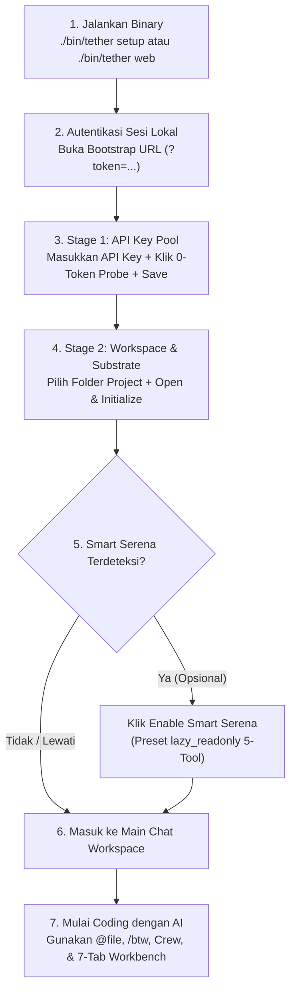

# Panduan & User Journey Setup Pertama Kali — Tether v0.3.0

Dokumen ini memandu perjalanan pengguna (*First-Time User Journey*) dari pertama kali menjalankan binary `tether` hingga siap bekerja dengan **AI Agent**, **File Mounting (`.tether/ignore`)**, **Same-Provider Crew**, **`/btw` Side-Chat**, dan **External MCP (Serena)**.

---

## Peta Perjalanan Pengguna (End-to-End Journey)



---

## Langkah 0: Persiapan Binary

Pastikan binary `tether` v0.3.0 sudah terkompilasi (single static binary murni Go, tanpa perlu Docker atau Node.js saat runtime):

```bash
cd /home/lenovo/crossparties/tether

# Cek versi binary
./bin/tether version
# Output: tether v0.3.0

# (Opsional) Cek kesehatan environment secara read-only
./bin/tether doctor
```

---

## Langkah 1: Menjalankan Tether untuk Pertama Kali

Ada **2 cara** untuk memulai setup pertama kali:

### Opsi A — Via Browser / Web UI *(Direkomendasikan)*
Jalankan salah satu perintah berikut di terminal Anda:

```bash
./bin/tether setup
# atau
./bin/tether web
```

Terminal akan menampilkan output seperti ini:

```text
TETHER WEB UI — Local Authenticated Server
  Workspace:     /home/lenovo/crossparties
  Bind Address:  http://127.0.0.1:8484
  Bootstrap URL: http://127.0.0.1:8484/?token=<64-hex-token>
  Press Ctrl+C to shut down cleanly.
```

> **Penting tentang Bootstrap Token (`?token=...`)**:
> - Klik langsung **Bootstrap URL** lengkap (`http://127.0.0.1:8484/?token=...`) dari terminal Anda.
> - Token tersebut bersifat **single-use (sekali pakai)** untuk menukar cookie sesi browser (`HttpOnly; SameSite=Strict`).
> - Setelah berhasil login pertama kali di browser tersebut, sesi Anda akan tersimpan otomatis di cookie browser selama server menyala.
> - Jika Anda membuka di browser berbeda atau token sudah terpakai, cukup tekan `Ctrl+C` di terminal lalu jalankan `./bin/tether web` lagi untuk mendapatkan Bootstrap URL baru.

### Opsi B — Via Terminal / SSH Headless (Tanpa Browser)
Jika Anda sedang berada di server SSH tanpa browser, jalankan:

```bash
./bin/tether setup --cli
```
Wizard interaktif di terminal akan memandu pengisian Provider, API Key, Model, serta inisialisasi `.tether/` secara langsung.

---

## Langkah 2: Onboarding Stage 1 — Konfigurasi API Key Pool

Begitu masuk ke Web UI untuk pertama kali, Anda akan berada di halaman **Setup (`Stage 1: Global API Key Pool & Provider Health`)**.

1. **Pilih Provider AI**:
   - `deepseek` (Default model: `deepseek-chat` atau `deepseek-reasoner`)
   - `openrouter` (Default model: `deepseek/deepseek-chat`, mendukung Claude/GPT/Gemini)
   - `openai` (`gpt-4o`), `gemini` (`gemini-2.5-pro`), `groq` (`llama-3.3-70b-versatile`), `xai` (`grok-2-latest`)
   - `ollama` (`qwen2.5-coder:7b` — lokal di `http://localhost:11434`, tidak memerlukan API key berbayar)
2. **Masukkan API Key**:
   - Tempelkan API key Anda (misal `sk-...`).
   - Key ini disimpan terenkripsi/terisolasi dengan izin ketat `0600` di `~/.config/tether/credentials.json` (tidak pernah disimpan di dalam database proyek `.tether/session.db` agar aman dari git commit).
3. **Klik `Probe (0-Token)`**:
   - Tether akan mengetes koneksi ke provider menggunakan *0-token health check* (`GET /models`) tanpa memotong kuota token Anda.
4. *(Opsional — Multi-Key Failover)*:
   - Jika Anda punya lebih dari 1 API key (misalnya 2 key DeepSeek + 1 key cadangan OpenRouter), klik **`+ Add Key`** untuk mengatur urutan prioritas failover otomatis saat terjadi rate-limit (`HTTP 429`) atau kredit habis (`HTTP 402`).
5. **Klik `Save Key Pool`**:
   - Setelah tersimpan, indikator Stage 1 akan berubah menjadi hijau.

---

## Langkah 3: Onboarding Stage 2 — Buka & Inisialisasi Workspace Proyek

Masih di halaman **Setup (`Stage 2: Workspace & Substrate Initialization`)**:

1. **Pilih Direktori Proyek**:
   - Secara default terisi direktori kerja saat ini, atau klik tombol **`Browse...`** (shortcut `Ctrl+O`) untuk memilih folder repositori kode Anda.
2. **Klik `Open & Initialize Project`**:
   - Tether otomatis menginisialisasi folder `.tether/` di dalam proyek Anda:
     - `.tether/session.db` (SQLite WAL Schema v5 untuk thread, memory, snapshot, dan mount)
     - `.tether/cache.db` (Cache AST/simbol `RepoMap` Pure-Go)
     - `.tether/ignore` (Aturan proteksi file dengan sintaks `.gitignore` + `re:`)
   - Aturan **Built-in Secret Guard** langsung aktif melindungi `.env`, `*.pem`, `*.key`, `.git`, `.ssh`, dan `.tether` di 5 titik (Read, Write, Shell, Indexing, dan `@file`).
3. *(Opsional)* **Kartu Rekomendasi Smart Serena (1-Click)**:
   - Jika proyek Anda memiliki banyak file kode, Tether akan menampilkan kartu rekomendasi **Serena MCP** dengan preset **`lazy_readonly`** (hanya mengaktifkan 5 tool navigasi simbol semantik read-only agar **KV Prompt Cache tetap >89%** dan tidak membengkakkan token).

---

## Langkah 4: Mengenal Area Kerja Utama (Main Workspace)

Setelah klik **`Continue to Workspace`**, Anda siap bekerja di **Chat Workspace** dan **7-Tab Workbench Drawer**:

### A. Fitur Utama di Chat Workspace (Kiri/Tengah)
| Fitur / Shortcut | Cara Pakai | Manfaat Utama |
| :--- | :--- | :--- |
| **Mode `CODE` vs `PLAN`** | Klik toggle di topbar atau ketik `/mode plan` | Mode `PLAN` memblokir semua modifikasi file sampai rencana disetujui. |
| **Attach File (`@file`)** | Ketik `@` di kotak chat (misal `@cmd/tether/main.go`) | Autocomplete file proyek; otomatis di-deduplikasi dengan SHA-256 agar tidak boros token jika file belum berubah. |
| **Side-Chat (`/btw`)** | Klik tombol **`/btw`** atau ketik `/btw <pertanyaan>` | Bertanya hal sela dengan konteks penuh **tanpa merusak KV Prompt Cache** percakapan utama (`0` byte mutasi). Hasilnya bisa di-*Promote to Main* atau *Pin as Decision*. |
| **Visual Diff Approval** | Muncul otomatis saat AI hendak mengubah file / menjalankan shell | Lihat diff baris-per-baris, lalu pilih **`Approve Once`**, **`Allow Folder / Prefix`**, **`Allow Session`**, atau **`Reject`** dengan alasan koreksi. |
| **Live Crew Pill** | Muncul saat `Main` mendelegasikan tugas ke `Crew` | Klik pill untuk memantau stream `Crew`, melakukan **`Abort Crew`**, atau **`Release Lease Lock`**. |
| **Command Palette** | Tekan **`Ctrl+K`** | Akses cepat ke semua aksi, pindah tab, compact context, atau ganti proyek (`Ctrl+O`). |

### B. 7-Tab Workbench Drawer (Panel Kanan)
1. **`Files`**: Mengatur mode akses per file/folder (`RW` Read-Write, `Guarded` wajib tanya, `RO` Read-Only, `Ignored` tersembunyi dari AI) serta mengedit `.tether/ignore` lengkap dengan **Live Impact Simulator**.
2. **`Diffs`**: Melihat perubahan file (*Tether Snapshots* vs *Git Diff*) dan melakukan **1-Click Undo** per Turn, per File, atau per Crew (dilengkapi deteksi konflik `PostHash` jika file sudah Anda edit manual di IDE).
3. **`Planner`**: Editor `.tether/PLAN.md` (CodeMirror 6) dengan tombol **`Start Building`** (bisa menyalakan *Auto-Critic* sebelum eksekusi).
4. **`Todos`**: Daftar progres tugas sesi yang ter-update secara live lewat SSE.
5. **`Terminal`**: Terminal interaktif asli (`@xterm/xterm` + Linux PTY via WebSocket `/api/v1/terminal/ws`).
6. **`Usage`**: Pantau **Context Pressure %**, **Cumulative KV-Cache Hit Ratio %**, tabel pemakaian token terpisah per `usage_id` (`main`, `btw`, `crew:<id>`, `condenser`), dan tombol **`Compact Now`**.
7. **`Preview`**: Pratinjau file HTML/web lokal di dalam sandbox aman (`/preview/...`).

---

## Langkah 5: Kustomisasi & Diagnostik Lanjutan

- **Menu `Customize` (di Topbar)**:
  - **Tab `MCP Servers`**: Tambah server MCP eksternal (`stdio` atau `HTTP/SSE`), impor otomatis dari `agy` / `claude` / `cursor`, uji koneksi wajib (**`1. Test Connection`** -> **`2. Save & Enable`**), dan pilih tool mana saja yang diaktifkan.
  - **Tab `Skills`**: Buat atau edit instruksi khusus di `.agents/skills/<nama>/SKILL.md` menggunakan editor CodeMirror 6.
  - **Tab `Memory`**: Kelola *Architectural Decisions* dan *Learned Patterns* yang tersimpan di projektu.
- **Menu `Settings` (di Topbar)**:
  - Ganti tema **Catppuccin Mocha (Dark)** / **Latte (Light)**, atur ambang `EpisodicCondenser` (default `72%` context window), cabut izin *Approval Grants*, atau jalankan **Interactive Doctor (`Run Check` / `Auto-Fix`)**.
