# Analisis Kelemahan Harness Tether vs. Efektivitas Agent Harness OpenHands

> **Repositori Target**: `github.com/crossparties/tether` (`internal/harness`, `internal/mcp`, `internal/orchestrator`, `internal/tui`)  
> **Repositori Pembanding**: `OpenHands/OpenHands` & OpenHands Agent Server Architecture  
> **Status Dokumen**: Analisis Arsitektur & Pencarian Solusi (*Analysis & Solution Design Phase — No Code Implementation*)  
> **Metodologi**: Eksplorasi Simbol, AST, dan Event Wire Fixtures menggunakan MCP (`serena` & `tree-sitter`)

Dokumen ini menjawab pertanyaan kritis: **"Mengapa cara bekerja OpenHands terasa sangat efektif, sedangkan Harness bawaan Tether (`internal/harness`) terasa kurang efektif, lambat, atau sering kehilangan arah?"**

 sebagaimana dicatat secara jujur di [`docs/STATUS.md`](file:///home/lenovo/crossparties/tether/docs/STATUS.md): kekuatan utama Tether saat ini ada pada **Substrat & Guardrail** (`internal/core`, `internal/hooks`, `internal/mcp`), sedangkan **Harness eksekusi agennya (`internal/harness`)** masih memiliki **8 kelemahan fundamental** dibanding arsitektur harness OpenHands.

---

## 1. Gambaran Arsitektural: Mengapa OpenHands Jauh Lebih Efektif?

Perbedaan efektivitas antara OpenHands dan Tether Harness berasal dari **paradigma desain loop eksekusi agen**:

```mermaid
flowchart TB
    subgraph TetherHarness["⚠️ Tether Harness Saat Ini (Stateless & High-Friction Loop)"]
        TH1["1. Tool Overload: 32 tool dijejalkan ke LLM\n(27 tool admin DB, hanya 4 tool koding, TANPA glob/grep!)"] --> TH2["2. Stateless Shell (30s hard timeout)\ncd, env, virtualenv hilang tiap run_command"]
        TH2 --> TH3["3. Read-Only Subagent + Double Approval\nSubagent hanya buat teks diff -> Main Agent harus\nbaca & edit ulang dari awal + 2x prompt approval"]
        TH3 --> TH4["4. In-Memory History Trap\nJika error/Ctrl+C di step ke-8, seluruh step 1..7\nhilang total dari r.history (Amnesia)"]
    end

    subgraph OpenHandsHarness["🚀 OpenHands Harness (Stateful, Durable & Low-Friction Loop)"]
        OH1["1. Laser-Focused Action Tools\n(Persistent Terminal, FileEditor, Glob, Grep,\nTaskTracker, ThinkTool, FinishTool)"] --> OH2["2. Persistent PTY/Tmux Shell Session\nState direktori, env, & proses bertahan lintas step"]
        OH2 --> OH3["3. Dedicated Planner (PLAN.md -> 1-Click Build)\n& Isolated Git Worktree Child Conversations"]
        OH3 --> OH4["4. Durable Event Stream + Stuck Detection\nSetiap step langsung tersimpan (Stop/Resume aman)\n+ Corrective Nudge saat model macet"]
    end
```



---

## 2. Bedah 8 Kelemahan Utama Harness Tether vs. Solusi OpenHands

### Kelemahan 1: Shell Stateless dengan Hard Timeout 30 Detik vs. *Persistent Stateful Shell*
* **Fakta di Kode Tether ([`toolRunCommand` di `internal/mcp/server.go:1538-1561`](file:///home/lenovo/crossparties/tether/internal/mcp/server.go#L1538-L1561))**:
  ```go
  ctx, cancel := context.WithTimeout(context.Background(), 30*time.Second)
  defer cancel()
  cmd := exec.CommandContext(ctx, "sh", "-c", params.Command)
  cmd.Dir = s.engine.Workspace
  ```
  1. **Stateless per Perintah**: Setiap `run_command` men-spawn proses `sh -c` baru yang selalu di-reset ke `s.engine.Workspace`. Jika agen menjalankan `cd subdir` atau `export FOO=bar` atau mengaktifkan `source .venv/bin/activate`, state tersebut **langsung hilang** pada perintah berikutnya.
  2. **Hard Timeout 30 Detik**: Timeout 30 detik yang di-hardcode membunuh proses kompilasi atau pengujian yang sah (seperti `npm test`, `go test -race ./...`, atau `cargo build`), membuat agen mengira kode rusak padahal hanya terkena `signal: killed`.
* **Mengapa OpenHands Sangat Efektif ([`reconnect-mid-stream.agent-server-1.47.0.json:4`](file:///home/lenovo/crossparties/OpenHands/__tests__/fixtures/session-socket/reconnect-mid-stream.agent-server-1.47.0.json#L4) & [`F27-workspace-tools.md:19-24`](file:///home/lenovo/crossparties/OpenHands/.agents/skills/verify-openhands/references/feature-map/F27-workspace-tools.md#L19-L24))**:
  * OpenHands menggunakan **`TerminalTool` berbasis sesi shell persisten (PTY / tmux)**. Direktori kerja (`working_dir`), environment variables, dan interpreter Python/Node bertahan lintas langkah, serta output terminal di-stream secara *live* ke panel Terminal tanpa memutus proses panjang secara prematur.
* **Solusi untuk Tether**:
  * Pertahankan *working directory* aktif (`cwd`) dan *environment map* per sesi di dalam `Runner` / `mcp.Server`, atau jalankan satu *persistent background shell / tmux pane* per sesi, serta naikkan timeout untuk perintah yang terdeteksi sebagai `safety.IsValidationCommand` (build/test) menjadi 180–300 detik.

---

### Kelemahan 2: Polusi 32 Skema Tool & Ketiadaan Native `glob` / `grep` vs. *Focused Coding Primitives*
* **Fakta di Kode Tether ([`Runner.Run` di `internal/harness/runner.go:347-377`](file:///home/lenovo/crossparties/tether/internal/harness/runner.go#L347-L377) & [`internal/mcp/server.go:220-600`](file:///home/lenovo/crossparties/tether/internal/mcp/server.go#L220-L600))**:
  1. **Polusi Pilihan Tool (*Tool Choice Dilution*)**: Tether mengirimkan **32 tool** ke LLM pada setiap langkah. Dari 32 tool tersebut, **27 adalah tool administratif database `session.db`** (4 tool todo terpisah, 4 tool grant/change, 3 tool proposal, 3 tool KB, 5 tool session/setting, dll.), dan **hanya 4 yang merupakan tool koding nyata** (`read_file`, `write_file`, `edit_file`, `run_command`). Banyaknya tool administratif membuat model sering terdistraksi memanggil tool metadata dibanding menyelesaikan kode.
  2. **Tidak Ada Tool `glob` dan `grep` Native di `mcp/server.go`**:
     Menariknya, [`internal/hooks/subagent_access.go`](file:///home/lenovo/crossparties/tether/internal/hooks/subagent_access.go) mengizinkan tool bernama `"glob"` dan `"grep"`, **tetapi `internal/mcp/server.go` sama sekali belum mengimplementasikan tool `glob` maupun `grep`!** Akibatnya, saat berjalan di harness Tether, agen hanya bisa mencari kode lewat `kb_search` (FTS5 BM25 yang tidak mendukung regex atau pencarian struktur direktori) atau terpaksa memanggil `run_command` (`grep -rn` / `find`), yang jauh lebih lambat dan memicu aturan keamanan shell.
* **Mengapa OpenHands Sangat Efektif ([`agent-server-adapter.ts:1357-1365`](file:///home/lenovo/crossparties/OpenHands/src/api/agent-server-adapter.ts#L1357-L1365) & [`F27.tasklist`](file:///home/lenovo/crossparties/OpenHands/.agents/skills/verify-openhands/references/feature-map/F27-workspace-tools.md#L30))**:
  * OpenHands memberikan set tool inti yang ringkas dan berdaya guna tinggi:
    * `glob` & `grep` (pencarian file dan regex super cepat tanpa perlu spawn shell bash).
    * `file_editor` (baca dengan nomor baris, edit presisi, buat file, dan undo).
    * `terminal` (eksekusi shell persisten).
    * `task_tracker` (**1 tool terpadu** untuk mengelola seluruh daftar tugas `todo` / `in_progress` / `done` sekaligus, menggantikan 4 tool `todo_add`, `todo_list`, `todo_complete`, `todo_remove` di Tether!).
* **Solusi untuk Tether**:
  * Tambahkan tool native `glob` dan `grep` di `internal/mcp/server.go`.
  * Gabungkan tool administratif yang jarang dipakai (misalnya 4 tool `todo_*` menjadi 1 tool `todo_manage`, dan sembunyikan tool `approve_change`/`reject_change` ketika tidak ada mutasi yang sedang menunggu), sehingga jumlah tool yang dikirim ke LLM turun dari 32 menjadi **~10 tool inti**.

---

### Kelemahan 3: `read_file` Tanpa Nomor Baris & Pemotongan Byte Buta vs. *Line-Numbered Viewport*
* **Fakta di Kode Tether ([`toolReadFile` di `internal/mcp/server.go:1303-1340`](file:///home/lenovo/crossparties/tether/internal/mcp/server.go#L1303-L1340))**:
  ```go
  if params.StartLine > 0 || params.EndLine > 0 {
      ...
      for i := start - 1; i < end; i++ {
          fmt.Fprintf(&b, "%d: %s\n", i+1, lines[i])
      }
      content = b.String()
  }
  if len(content) > 32768 {
      return content[:32768] + "\n... [truncated at 32KB]", false
  }
  ```
  1. Ketika agen memanggil `read_file({"path": "main.go"})` tanpa parameter `start_line`/`end_line` (pola panggilan paling umum), `toolReadFile` mengembalikan isi file **tanpa nomor baris sama sekali**!
  2. Jika file lebih besar dari 32 KB, `content[:32768]` memotong di tengah baris (bahkan berpotensi membelah byte UTF-8 multi-byte) tanpa memberi tahu agen berapa total baris file tersebut (`file has X lines, showing lines 1-Y`). Akibatnya, agen buta posisi baris dan sering gagal saat ingin membaca bagian bawah file atau saat menyusun target `edit_file`.
* **Mengapa OpenHands Sangat Efektif**:
  * `file_editor` di OpenHands selalu menyertakan nomor baris dan informasi rentang viewport (`Showing lines A-B of Total`), sehingga model dapat langsung melakukan pengeditan akurat pada percobaan pertama.

---

### Kelemahan 4: Alur Subagent "Kerja Dua Kali" + Bug Logika Proposal Gate vs. *Planner-to-Build & Worktree Child Agent*
* **Fakta di Kode Tether ([`runSubagentWithCtx` di `internal/harness/runner.go:528-664`](file:///home/lenovo/crossparties/tether/internal/harness/runner.go#L528-L664) & [`cmd/tether/main.go:852`](file:///home/lenovo/crossparties/tether/cmd/tether/main.go#L852))**:
  1. **Friksi "Kerja Dua Kali" (*Double-Work Overhead*)**:
     Di Tether, subagent dipaksa 100% *read-only* (`runner.go:303-310`). Ketika Main Agent mendelegasikan tugas koding ke subagent (`tether_frontend` / `tether_architect`), subagent membaca file-file, lalu menulis usulan perubahan sebagai teks diff di dalam laporan chat. Setelah subagent selesai:
     * Outputnya disimpan sebagai `Proposal` yang **mengunci seluruh workspace**.
     * User harus menyetujui proposal terlebih dahulu.
     * Setelah disetujui, **proposal tersebut tidak otomatis diterapkan ke file!** Main Agent harus membaca ulang laporan subagent dan memanggil `edit_file` / `write_file` satu per satu dari awal (yang kemudian dapat memicu prompt persetujuan kedua di MCP approval gate!).
  2. **Bug Logika di `runner.go:642`**:
     Perhatikan baris 642 di [`internal/harness/runner.go`](file:///home/lenovo/crossparties/tether/internal/harness/runner.go#L642):
     ```go
     if !producesMutation(role, ans) || !producesMutation("tether_qa", ans) {
         run.Analysis = true
         r.printRunSummary(run)
         return fmt.Sprintf("[Subagent %s Report]:\n%s", role, ans)
     }
     ```
     Karena `analysisOnlyRoles["tether_qa"]` bernilai `true` (`runner.go:1008`), ekspresi `!producesMutation("tether_qa", ans)` selalu bernilai `true` setiap kali teks `ans` tidak memuat fence ```` ```diff ```` atau `--- a/`. Akibatnya, kondisi pertama `!producesMutation(role, ans)` menjadi tidak berguna karena di-OR dengan `"tether_qa"`.
  3. **Diskoneksi `orchestrator.Engine` dengan `Runner` (`main.go:852`)**:
     Di `cmd/tether/main.go:852`, `orch := orchestrator.NewEngine()` diinisialisasi dan dihubungkan ke TUI, tetapi saat LLM memanggil tool `spawn_subagent` di dalam `Runner.Run`, `runSubagentWithCtx` mengeksekusi goroutine-nya sendiri tanpa mendaftarkan worker ke `orch.SpawnWorker`!
* **Mengapa OpenHands Sangat Efektif ([`src/utils/plan-file.ts:15-60`](file:///home/lenovo/crossparties/OpenHands/src/utils/plan-file.ts#L15-L60), [`agent-server-adapter.ts:1317-1438`](file:///home/lenovo/crossparties/OpenHands/src/api/agent-server-adapter.ts#L1317-L1438), & [`launch-child-conversation-client-tool.ts:60-111`](file:///home/lenovo/crossparties/OpenHands/src/api/launch-child-conversation-client-tool.ts#L60-L111))**:
  1. **Structured Planning Agent (`.agents_tmp/PLAN.md` $\rightarrow$ 1-Click Build)**:
     Di OpenHands, agen perencana hanya memiliki 3 tool (`glob`, `grep`, dan `planning_file_editor` yang terkunci hanya ke `.agents_tmp/PLAN.md`) serta struktur wajib 5 bagian (`OBJECTIVE`, `CONTEXT SUMMARY`, `APPROACH OVERVIEW`, `IMPLEMENTATION STEPS`, `TESTING AND VALIDATION`). Begitu rencana selesai ditulis ke `PLAN.md`, user cukup menekan tombol **Build (`⌘↩`)** dan Code Agent langsung mengeksekusi `PLAN.md` tersebut tanpa birokrasi berlapis.
  2. **Isolated Git Worktree Child Agents (`launch_child_conversation`)**:
     Ketika OpenHands men-spawn *child conversation* lokal, default isolasinya adalah **`isolation: "worktree"`**—child agent bekerja di *Git worktree* dan branch terpisah, sehingga ia bisa langsung menulis kode dan menjalankan unit test secara nyata tanpa merusak working tree utama!

---

### Kelemahan 5: Amnesia Saat Interupsi / Error di Tengah Turn vs. *Durable Step-by-Step Event Stream*
* **Fakta di Kode Tether ([`Runner.Run` di `internal/harness/runner.go:382-404, 447`](file:///home/lenovo/crossparties/tether/internal/harness/runner.go#L382-L404))**:
  * Di dalam `Runner.Run`, variabel slice lokal `messages` menampung seluruh progres tool call selama turn berlangsung.
  * Namun, `r.history = messages` **hanya disimpan di akhir turn** ketika `len(msg.ToolCalls) == 0` (baris 401) atau ketika mencapai batas `MaxSteps` (baris 447).
  * **Konsekuensi Fatal**: Jika agen sudah berhasil menjalankan 7 langkah tool (membaca 5 file dan mengedit 2 file), lalu pada langkah ke-8 terjadi gangguan jaringan (`err != nil` di baris 386) atau user menekan `Esc` / `Ctrl+C` untuk menghentikan proses yang lambat, `Runner.Run` langsung melakukan `return "", err` **tanpa menyimpan `messages` ke `r.history`!**
  * Ketika user mengetik pesan berikutnya (misalnya *"lanjutkan"*), `r.history` masih berada pada kondisi sebelum langkah ke-1. Agen mengalami **amnesia total** terhadap 7 langkah yang baru saja ia kerjakan dan mengulang semuanya dari awal!
* **Mengapa OpenHands Sangat Efektif ([`F06.stop-resume`, `F06.reload-mid-run`](file:///home/lenovo/crossparties/OpenHands/.agents/skills/verify-openhands/references/feature-map/F06-agent-activity.md#L46-L48))**:
  * Di OpenHands, setiap `ActionEvent` dan `ObservationEvent` langsung disimpan ke *event store* begitu langkah tersebut selesai (`seq: 1, 2, 3...`). Jika user menekan **Stop** di tengah jalan atau koneksi terputus, seluruh langkah yang sudah selesai tetap tersimpan utuh, dan tombol **Resume (Play)** melanjutkan tepat dari langkah terakhir.
* **Solusi untuk Tether**:
  * Simpan `r.history = messages` (dengan memastikan setiap `assistant` message yang memiliki `tool_calls` sudah dipasangkan dengan pesan `tool` responsnya, atau tambahkan placeholder `"interrupted by user"` untuk `tool_call_id` yang belum selesai) pada `defer` di dalam `Runner.Run`, sehingga interupsi tidak pernah menghapus progres langkah-langkah sebelumnya.

---

### Kelemahan 6: Loop Kontrol Kognitif yang Rapuh vs. *ThinkTool, FinishTool, Corrective Nudge & Stuck Detection*
* **Fakta di Kode Tether ([`Runner.Run` di `internal/harness/runner.go:300, 400-404`](file:///home/lenovo/crossparties/tether/internal/harness/runner.go#L300))**:
  1. **System Prompt Terlalu Minim**: System prompt Main Agent di baris 300 hanya berisi 3 kalimat generik (`"You are the Main Orchestrator of an autonomous coding agent CLI anchored by Tether. Be concise, direct, and technical..."`). Tidak ada panduan metodologi rekayasa (mis. *Explore $\rightarrow$ Plan $\rightarrow$ Edit $\rightarrow$ Verify with Tests*), tidak ada instruksi penggunaan `edit_file` vs `write_file`, dan tidak ada panduan efisiensi batching tool.
  2. **Terminasi Prematur (`len(msg.ToolCalls) == 0`)**: Begitu model mengembalikan pesan tanpa `tool_calls` (misalnya model hanya berkata *"Baik, saya akan memeriksa file tersebut sekarang."* tetapi lupa menyertakan JSON `tool_calls`), Tether langsung menganggap tugas selesai dan keluar dari loop!
  3. **Tidak Ada Deteksi Looping (*Stuck Detection*)**: Jika `edit_file` gagal berkali-kali karena `target string not found`, model dapat mengulangi panggilan `edit_file` yang sama puluhan kali tanpa diintervensi oleh harness.
* **Mengapa OpenHands Sangat Efektif ([`reconnect-mid-stream.agent-server-1.47.0.json:4`](file:///home/lenovo/crossparties/OpenHands/__tests__/fixtures/session-socket/reconnect-mid-stream.agent-server-1.47.0.json#L4) & [`F06.corrective-nudge`](file:///home/lenovo/crossparties/OpenHands/.agents/skills/verify-openhands/references/feature-map/F06-agent-activity.md#L59))**:
  1. **Structured `<SOUL>` & `<ROLE>` System Prompt**: Memberikan SOP eksplorasi, pengeditan, dan verifikasi yang sangat jelas kepada model.
  2. **Explicit `FinishTool` & `ThinkTool`**: Agen menggunakan `think` untuk merancang hipotesis saat debugging, dan memanggil `finish` secara eksplisit saat seluruh kriteria tugas terpenuhi.
  3. **Corrective Nudge (`F06.corrective-nudge`)**: Jika model merespons kosong atau berhenti tanpa penyelesaian yang jelas, SDK mengirimkan *corrective nudge* otomatis.
  4. **Stuck Detection (`stuck_detection: true`)**: Memutus siklus saat agen mengulangi aksi dan error yang sama.

---

### Kelemahan 7: Eksekusi Tool Baca Sekuensial vs. *Parallel Read-Only Tool Execution*
* **Fakta di Kode Tether ([`Runner.Run` di `internal/harness/runner.go:407-441`](file:///home/lenovo/crossparties/tether/internal/harness/runner.go#L407-L441))**:
  * Tether hanya menjalankan tool secara paralel (`sync.WaitGroup`) apabila **seluruh** tool call dalam satu langkah adalah `spawn_subagent` (`allSubagents`).
  * Jika model memanggil 5 `read_file` atau 4 `kb_search` sekaligus dalam satu langkah, semuanya dijalankan satu per satu di dalam loop sekuensial.
* **Mengapa OpenHands Sangat Efektif ([`sdk-settings-field-metadata.test.ts:308-312`](file:///home/lenovo/crossparties/OpenHands/src/utils/sdk-settings-field-metadata.test.ts#L308-L312))**:
  * Mendukung eksekusi tool paralel (`tool_concurrency_limit`), sehingga pembacaan banyak file atau pencarian kode selesai dalam satu gelombang konkuren.

---

### Kelemahan 8: Kualitas Pencarian FTS5 (`IndexDirectory`) pada Kode Sumber
* **Fakta di Kode Tether ([`bootstrapSubstrate` di `internal/harness/runner.go:201-211`](file:///home/lenovo/crossparties/tether/internal/harness/runner.go#L201-L211) & [`internal/core/engine.go`](file:///home/lenovo/crossparties/tether/internal/core/engine.go))**:
  * Saat `NewRunner` dibuat, `bootstrapSubstrate` hanya mengindeks direktori ke FTS5 (`kb_fts`) **jika `stats.TotalFiles == 0`** (hanya sekali pada saat database pertama kali dibuat!).
  * Jika ada file baru yang dibuat di luar `write_file`/`edit_file` MCP (misalnya melalui `git pull`, editor IDE, atau perintah shell), indeks `kb_search` menjadi **basi (*stale*)**.
  * Selain itu, FTS5 melakukan tokenisasi kata biasa yang kurang cocok untuk mencari simbol kode dengan karakter khusus atau regex, sementara OpenHands mengandalkan kombinasi `glob` + `grep` langsung terhadap filesystem aktual yang selalu *real-time*.

---

## 3. Matriks Perbandingan Komprehensif: Tether Harness vs. OpenHands Harness

| Dimensi Harness | Tether Harness Saat Ini (`internal/harness`) | OpenHands Harness (`Agent Server + Canvas`) | Solusi Pengembangan untuk Tether |
| :--- | :--- | :--- | :--- |
| **1. Eksekusi Terminal / Shell** | Stateless `sh -c` per panggilan + hard timeout 30s (`server.go:1545`). `cd` dan `env` hilang tiap perintah. | **Persistent PTY / Tmux Shell Session** (`TerminalTool`). State direktori, env, dan proses bertahan. | Simpan `cwd` & `env` per sesi di `mcp.Server` atau gunakan persistent shell process; bedakan timeout perintah baca (30s) vs build/test (300s). |
| **2. Desain & Jumlah Tool** | **32 tool** dalam 1 payload (27 tool admin DB, 4 tool file/shell, **0 tool `glob`/`grep`**). | **4–6 Core Action Tools** (`terminal`, `file_editor`, `glob`, `grep`, `task_tracker`, `think`, `finish`). | Implementasikan `glob` & `grep` native di `mcp/server.go`; konsolidasikan 4 tool `todo_*` menjadi 1 tool `todo_manage`. |
| **3. Pembacaan File (`read_file`)** | Tanpa nomor baris saat baca file penuh; potong paksa di byte 32,768 tanpa info total baris (`server.go:1316`). | **Line-Numbered Viewport** (`1: ...`) beserta metadata `Showing lines X-Y of Total`. | Selalu cetak nomor baris `1..N` pada `read_file` dan potong berdasarkan batas baris (mis. 400 baris per baca) beserta info total baris. |
| **4. Arsitektur Subagent & Planning** | Subagent 100% read-only $\rightarrow$ hasilkan teks diff $\rightarrow$ kunci workspace dengan Proposal $\rightarrow$ Main Agent harus edit ulang dari awal + bug OR `tether_qa` di `runner.go:642`. | **Dedicated Planner (`.agents_tmp/PLAN.md` + 1-Click Build)** & **Isolated Git Worktree Child Agents** (`launch_child_conversation`). | Perbaiki bug `runner.go:642`; gunakan file rencana `.tether/PLAN.md` saat mode `plan`; atau izinkan subagent bekerja di dalam *Git worktree* / snapshot branch terisolasi. |
| **5. Ketahanan State Saat Stop / Error** | `r.history` hanya disimpan saat turn selesai normal (`runner.go:401`). Error/Ctrl+C di tengah jalan menghapus seluruh langkah tool pada turn tersebut. | **Durable Per-Event Persistence** (`ActionEvent` & `ObservationEvent`). Stop & Resume melanjutkan tepat dari langkah terakhir. | Update `r.history` secara inkremental setelah setiap pasangan `assistant` tool call + `tool` result selesai dieksekusi. |
| **6. Kontrol Kognitif & Anti-Looping** | System prompt 3 kalimat; tidak ada deteksi loop; berhenti begitu saja jika model lupa mengirim tool call. | **Structured System Prompt + `ThinkTool` + `FinishTool` + `stuck_detection: true` + Corrective Nudge**. | Tambahkan deteksi 3x tool call identik (*stuck detector*), *corrective nudge* saat output kosong, dan perkaya system prompt dengan SOP *Locate-Edit-Verify*. |
| **7. Konkurensi Tool Calls** | Paralel hanya jika semua tool adalah `spawn_subagent` (`runner.go:407`). `read_file` ganda tetap sekuensial. | **Configurable `tool_concurrency_limit`** untuk mengeksekusi tool paralel. | Eksekusi seluruh batch tool *read-only* (`read_file`, `glob`, `grep`, `kb_search`) secara paralel menggunakan `sync.WaitGroup`. |
| **8. Prompt Caching & Compaction** | Mutasi ekor `messages[0]` tiap turn + *sliding compaction* `keepTurns=2` tiap step = **Cache Miss Tinggi**. | **Immutable `SystemPromptEvent` + Append-Only Stream + Episodic Condenser (`max_size=240`)** = **95% Cache Hit**. | Bekukan `messages[0]`, kirim perubahan state sebagai *Tail Delta*, dan gunakan *High/Low-Water-Mark Episodic Compaction*. |
