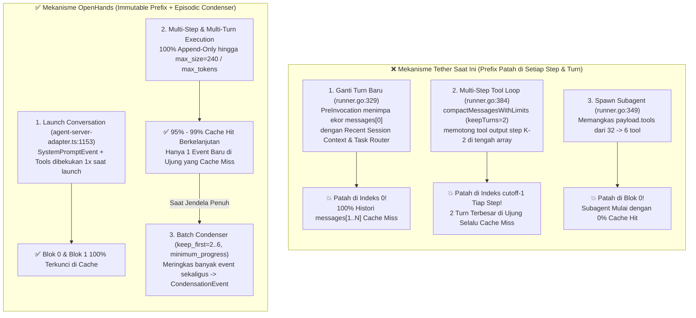

# Analisis Kelemahan Tether & Blueprint Solusi Pengembangan Berbasis Arsitektur OpenHands

> **Repositori Target**: `github.com/crossparties/tether` (v0.2.0)  
> **Repositori Referensi Solusi**: `OpenHands/OpenHands` (Agent Canvas v1.43.0)  
> **Status Dokumen**: Analisis Arsitektur & Pencarian Solusi (*Design & Analysis Phase — No Code Mutation*)  
> **Metodologi**: Audit AST, Call-Graph, dan Simbol Lintas-Repositori secara Maksimal menggunakan MCP (`serena` & `tree-sitter`)

Dokumen ini memetakan **kelemahan-kelemahan teknis Tether saat ini yang masih dapat dikembangkan**—dengan fokus utama pada **mengapa Prompt Caching di Tether mengalami *cache miss* yang sangat jauh dibanding OpenHands**, ditambah **5 dimensi kelemahan sistemik lainnya** yang ditemukan dari perbandingan langsung kode sumber Tether dan OpenHands.

---

## Bagian I: Fokus Utama — Mengapa Prompt Caching Tether Meleset Jauh Dibanding OpenHands?

Pada seluruh provider LLM modern (DeepSeek 64-token prefix block cache, OpenAI, Anthropic, Gemini), **KV-Cache di sisi server LLM bekerja dengan aturan *Strict Left-to-Right Prefix Matching***:

$$\text{Urutan Byte/Token Prefix} = \underbrace{\text{payload.tools}}_{\text{Blok 0}} \rightarrow \underbrace{\text{messages}[0] (\text{System})}_{\text{Blok 1}} \rightarrow \underbrace{\text{messages}[1]}_{\text{Blok 2}} \rightarrow \dots \rightarrow \underbrace{\text{messages}[N]}_{\text{Blok } N}$$

> [!CAUTION]
> **Hukum Fisika KV-Cache LLM:**
> Jika ada **1 token saja berubah, disisipkan, atau dihapus pada indeks $K$**, maka **100% token dari indeks $K$ hingga $N$ mengalami CACHE MISS**, walaupun isi pesan pada indeks $K+1 \dots N$ tidak berubah sama sekali.

Melalui penelusuran simbol MCP `serena` (`find_symbol` & `find_referencing_symbols`) pada [`internal/harness/runner.go`](file:///home/lenovo/crossparties/tether/internal/harness/runner.go), [`internal/hooks/handler.go`](file:///home/lenovo/crossparties/tether/internal/hooks/handler.go), [`internal/harness/stream.go`](file:///home/lenovo/crossparties/tether/internal/harness/stream.go), dan [`internal/harness/btw.go`](file:///home/lenovo/crossparties/tether/internal/harness/btw.go), ditemukan **5 kelemahan struktural di Tether** yang merusak *prefix cache*:



### 1. Detail 5 Kelemahan Prompt Caching pada Tether

#### Kelemahan 1.1: Mutasi Ekor `messages[0]` (System Prompt) di Setiap Turn Baru
* **Bukti Simbol Kode Tether**: [`Runner.Run` (`runner.go:295-330`)](file:///home/lenovo/crossparties/tether/internal/harness/runner.go#L295-L330) & [`Handler.handlePreInvocation` (`handler.go:196-332`)](file:///home/lenovo/crossparties/tether/internal/hooks/handler.go#L196-L332).
* **Analisis**:
  Setiap kali pengguna mengirim pesan baru, `Runner.Run()` memanggil hook `PreInvocation` dan menimpa elemen paling awal array pesan:
  ```go
  messages[0] = chatMessage{Role: "system", Content: sysPrompt}
  ```
  Walaupun bagian atas `PreInvocation` sudah mengurutkan `Project Settings` secara abjad, bagian bawah `PreInvocation` selalu menyuntikkan data yang berubah di setiap turn:
  1. `Recent Session Context` (`h.engine.GetRecentContext(50)` di `handler.go:286-300`): Mengambil 6 pesan terakhir yang **pasti berubah** setelah setiap turn selesai.
  2. `Project Tasks / Todos (Pending)` (`handler.go:278-284`): Berubah setiap kali ada `todo_add` atau `todo_complete`.
  3. `Previous Decisions` & `Learned Patterns` (`handler.go:263-276`): Berubah setiap kali ada `decision_add` atau `pattern_add`.
  4. `Task Router` (`core.ClassifyTask(input.Prompt)` di `handler.go:302-320`): Berubah mengikuti isi prompt baru.
* **Mengapa `deepseek_opt_test.go` Menyesatkan**:
  Unit test di [`deepseek_opt_test.go:46-62`](file:///home/lenovo/crossparties/tether/internal/harness/deepseek_opt_test.go#L46-L62) hanya menguji bahwa 85% bagian awal `messages[0]` (~300 token) tetap sama. Test tersebut lupa bahwa karena **15% ekor `messages[0]` berubah di Indeks 0**, maka **seluruh histori percakapan multi-turn di belakangnya (`messages[1..N]`, yang bisa berisi 5.000–40.000 token kode dan tool output) mengalami 100% Cache Miss pada setiap turn baru!**

#### Kelemahan 1.2: *Per-Step Sliding-Window Compaction* (`keepTurns = 2`) di Tengah Loop Tool
* **Bukti Simbol Kode Tether**: [`Runner.Run` (`runner.go:382-385`)](file:///home/lenovo/crossparties/tether/internal/harness/runner.go#L382-L385) & [`compactMessagesWithLimits` (`runner.go:918-971`)](file:///home/lenovo/crossparties/tether/internal/harness/runner.go#L918-L971).
* **Analisis**:
  Di dalam loop eksekusi tool (`for step := 0; step < r.cfg.MaxSteps; step++`), Tether memanggil `compactMessagesWithLimits(messages, 2, 800)` **pada setiap langkah sebelum memanggil `callAPI`**.
  Perhatikan apa yang terjadi ketika agen melakukan 6 langkah tool berturut-turut (misalnya membaca beberapa file kode yang masing-masing berukuran >800 karakter):
  * **Step 1**: `[sys, user, asst_1, tool_1 (4000 char)]` $\rightarrow$ Terkirim utuh.
  * **Step 2**: `[sys, user, asst_1, tool_1 (4000 char), asst_2, tool_2 (4000 char)]` $\rightarrow$ `tool_1` masih dalam jendela `keepTurns = 2`, sehingga prefix Step 1 (`sys..tool_1`) **Cache Hit**.
  * **Step 3**: `turnsSeen` mencapai `2`! Fungsi `compactMessagesWithLimits` menggeser `cutoff` dan **memodifikasi `tool_1` (di indeks 3!)** menjadi 600 karakter (`"... [compacted 3400 chars ...]"`).
    * Akibatnya: Prefix patah di **indeks 3**! Seluruh isi `asst_2`, `tool_2 (4000 char)`, `asst_3`, dan `tool_3 (4000 char)` yang berada di sebelah kanan indeks 3 mengalami **100% Cache Miss**!
  * **Step 4**: `cutoff` bergeser maju 1 langkah lagi dan **memodifikasi `tool_2` (di indeks 5!)** menjadi 600 karakter.
    * Akibatnya: Prefix patah di **indeks 5**! Seluruh isi `asst_3`, `tool_3 (4000 char)`, `asst_4`, dan `tool_4 (4000 char)` mengalami **100% Cache Miss**!
  * **Step 5**: `cutoff` bergeser maju lagi dan **memodifikasi `tool_3` (di indeks 7!)** $\rightarrow$ `tool_4` dan `tool_5` mengalami **100% Cache Miss**!
* **Kesimpulan Matematis**: Karena jendela `keepTurns = 2` bergeser 1 langkah pada setiap step, **2 turn terakhir yang justru berukuran paling besar (karena belum dipotong) TIDAK PERNAH berhasil masuk ke dalam prefix cache!**

#### Kelemahan 1.3: Pemangkasan Skema `tools` pada Subagent Menghanguskan Cache Utama
* **Bukti Simbol Kode Tether**: [`Runner.Run` (`runner.go:339-377`)](file:///home/lenovo/crossparties/tether/internal/harness/runner.go#L339-L377).
* **Analisis**:
  Main Agent mengirimkan 32 definisi tool di field JSON `tools`. Saat `spawn_subagent` dipanggil, `subRunner` memfilter `apiTools` menjadi hanya 6 tool dan mengganti `messages[0]` dengan prompt subagent. Karena di sisi engine LLM field `tools` berada di **Blok 0 (paling kiri sebelum `messages[0]`)**, perubahan daftar tool dari 32 menjadi 6 membuat prefix berbeda sejak token pertama. Akibatnya, subagent selalu mulai dengan **0% Cache Hit** dan tidak bisa memanfaatkan prefix cache `tools` + `system prompt` milik Main Agent (~2.000+ token).

#### Kelemahan 1.4: Penghapusan `ReasoningContent` & Compaction Saat Transisi Turn
* **Bukti Simbol Kode Tether**: [`Runner.Run` (`runner.go:331-335, 401`)](file:///home/lenovo/crossparties/tether/internal/harness/runner.go#L331-L335).
* **Analisis**:
  Selama sebuah turn multi-step aktif, field `reasoning_content` dipertahankan pada pesan `assistant`. Saat turn berakhir (`line 401`) dan turn berikutnya dimulai (`line 331-335`), Tether menghapus `ReasoningContent` dari pesan `assistant` sebelumnya serta mengompresi output tool dari turn sebelumnya, yang mengubah representasi token dari histori turn terakhir tersebut.

#### Kelemahan 1.5: Tidak Ada Eksplisit Cache Breakpoints / Retention Flags & Kelemahan Telemetri
* **Bukti Simbol Kode Tether**: [`callAPI` (`runner.go:737-816`)](file:///home/lenovo/crossparties/tether/internal/harness/runner.go#L737-L816), [`streamRequest` (`stream.go:98-107`)](file:///home/lenovo/crossparties/tether/internal/harness/stream.go#L98-L107), & [`StatusSummary` (`btw.go:120-136`)](file:///home/lenovo/crossparties/tether/internal/harness/btw.go#L120-L136).
* **Analisis**:
  1. Tether hanya mengandalkan *automatic prefix caching* milik DeepSeek/OpenAI dan belum mengirimkan atribut `cache_control` / `cache_prompt` atau `prompt_cache_retention` untuk provider seperti Anthropic / OpenRouter.
  2. Variabel `r.lastCacheHitTokens` dan `r.lastCacheMissTokens` hanya merekam **1 request terakhir** (bukan akumulasi sesi), tertimpa oleh panggilan `/btw` (`RunSideChat` di `btw.go:246` yang mengirim `tools: nil`), dan salah menghitung persentase pada provider OpenAI/OpenRouter/Gemini yang hanya mengembalikan `prompt_tokens` dan `cached_tokens` (tanpa field `prompt_cache_miss_tokens`).

---

### 2. Bagaimana OpenHands Menyelesaikan Masalah Prompt Caching Ini?

Berdasarkan hasil inspeksi simbol MCP `serena` dan `tree-sitter` pada repositori **OpenHands**, berikut adalah **4 solusi arsitektural OpenHands** yang terbukti menjaga *cache hit* di kisaran **90%–98%**:

| Komponen Solusi di OpenHands | Lokasi Bukti Kode di OpenHands (via MCP `serena`) | Mekanisme Teknis yang Dapat Diadopsi ke Tether |
| :--- | :--- | :--- |
| **1. Launch-Time Immutable `SystemPromptEvent` & Cached Tool Schemas** | [`buildStartConversationRequest` (`src/api/agent-server-adapter.ts:1153-1205`)](file:///home/lenovo/crossparties/OpenHands/src/api/agent-server-adapter.ts#L1153-L1205), [`buildAgentContext` (`line 914-962`)](file:///home/lenovo/crossparties/OpenHands/src/api/agent-server-adapter.ts#L914-L962), [`buildRuntimeServicesSystemSuffix` (`line 273-358`)](file:///home/lenovo/crossparties/OpenHands/src/api/agent-server-adapter.ts#L273-L358) | Seluruh instruksi sistem, skills, `.openhands/memory/`, dan suffix layanan dirakit **satu kali saat percakapan diluncurkan** (`system_message_suffix_append`). Setelah sesi dimulai, `SystemPromptEvent` (Indeks 0) dan skema `tools` **dibekukan 100%** dan tidak pernah dimodifikasi di tengah sesi. |
| **2. Strict Append-Only Stream + Threshold-Driven Episodic Condenser** | [`buildStartPlanningConversationRequest` (`src/api/agent-server-adapter.ts:1388-1393`)](file:///home/lenovo/crossparties/OpenHands/src/api/agent-server-adapter.ts#L1388-L1393), [`SCHEMA_FIELDS` (`src/utils/sdk-settings-field-metadata.test.ts:314-349`)](file:///home/lenovo/crossparties/OpenHands/src/utils/sdk-settings-field-metadata.test.ts#L314-L349) | OpenHands **tidak pernah** menggunakan *sliding window per-step*. Histori dibiarkan **100% Append-Only** hingga menyentuh ambang batas tinggi (`max_size = 240` event atau `max_tokens`). Saat ambang tercapai, `LLMSummarizingCondenser` mempertahankan `keep_first` (`2`–`6` event awal) dan meringkas porsi besar sekaligus (`minimum_progress`) menjadi satu [`CondensationEvent`](file:///home/lenovo/crossparties/OpenHands/src/types/agent-server/type-guards.ts#L325-L328). |
| **3. Explicit Prompt Cache Config & Breakpoints** | [`reconnect-mid-stream.agent-server-1.47.0.json:4`](file:///home/lenovo/crossparties/OpenHands/__tests__/fixtures/session-socket/reconnect-mid-stream.agent-server-1.47.0.json#L4) | Konfigurasi LLM di OpenHands secara eksplisit menyetel `"caching_prompt": true`, `"prompt_cache_retention": "24h"`, dan menandai blok konten dengan `"cache_prompt": true/false` untuk mendukung cache breakpoint lintas provider. |
| **4. Visual Context Window Meter, Tombol Manual Compact & Per-Usage-ID Telemetry** | [`ContextMeter` (`context-meter.tsx:34-103`)](file:///home/lenovo/crossparties/OpenHands/src/components/features/conversation/usage-panel/context-meter.tsx#L34-L103), [`CompactContextButton` (`compact-context-button.tsx:23-78`)](file:///home/lenovo/crossparties/OpenHands/src/components/features/conversation/usage-panel/compact-context-button.tsx#L23-L78), [`useCompactContextAction` (`use-compact-context-action.ts:25-118`)](file:///home/lenovo/crossparties/OpenHands/src/hooks/use-compact-context-action.ts#L25-L118), [`combineUsageMetrics` (`conversation-metrics.ts:11-72`)](file:///home/lenovo/crossparties/OpenHands/src/utils/conversation-metrics.ts#L11-L72) | Memisahkan metrik tekanan jendela konteks saat ini (`per_turn_token / context_window`) dari akumulasi token sesi (`prompt_tokens`, `cache_read_tokens`, `cache_write_tokens`) yang dipisah per `usage_id` (mis. `agent` vs `planning_condenser`), serta memberi kontrol manual kepada user untuk memadatkan konteks kapan saja. |

---

## Bagian II: 5 Kelemahan Sistemik Lainnya di Tether & Solusi dari OpenHands

Selain Prompt Caching, eksplorasi MCP (`serena` & `tree-sitter`) lintas repositori menemukan **5 area kelemahan lain pada Tether** yang pernah memicu kendala nyata (termasuk insiden *session stuck / context canceled* yang terekam di `tether/session.db`) dan sudah memiliki pola solusi matang di **OpenHands**:

### 1. Ketahanan Jaringan, Retry Backoff, & Stuck-Loop Detection
* **Kelemahan di Tether**:
  * Berdasarkan jejak insiden nyata di `session.db` (*"Itu DeepSeek yang memutus koneksi... request ke model yang menggantung — makanya waktu di-cancel, provider balas 'context canceled'"*) dan kode [`streamRequest` (`internal/harness/stream.go:54-85`)](file:///home/lenovo/crossparties/tether/internal/harness/stream.go#L54-L85):
    1. `streamRequest` menggunakan `client := &http.Client{Transport: r.client.Transport}` **tanpa timeout per-chunk (idle read timeout) dan tanpa `ResponseHeaderTimeout`**. Ketika koneksi TCP ke DeepSeek menggantung di tengah jalan (terutama saat *prefill* lambat akibat *cache miss*), goroutine pembaca `reader.ReadString('\n')` akan membeku tanpa batas waktu sampai user menekan `Ctrl+C`.
    2. **Nol Retry & Exponential Backoff**: `callAPI` ([`runner.go:781`](file:///home/lenovo/crossparties/tether/internal/harness/runner.go#L781)) langsung gagal pada percobaan pertama jika API mengembalikan HTTP 429 (Rate Limit), 502, 503, atau `io.ErrUnexpectedEOF`.
    3. **Tidak Ada Stuck-Loop Detection**: Jika model mengalami *looping* (memanggil tool dan argumen yang sama berulang-ulang dengan hasil error yang sama), Tether terus membiarkannya berjalan hingga `MaxSteps = 80`.
* **Solusi dari OpenHands**:
  * Di [`reconnect-mid-stream.agent-server-1.47.0.json:4`](file:///home/lenovo/crossparties/OpenHands/__tests__/fixtures/session-socket/reconnect-mid-stream.agent-server-1.47.0.json#L4) dan [`agent-server-adapter.ts:1214`](file:///home/lenovo/crossparties/OpenHands/src/api/agent-server-adapter.ts#L1214):
    1. **Exponential Backoff Retry**: `num_retries: 5, retry_multiplier: 8, retry_min_wait: 8, retry_max_wait: 64, timeout: 300`.
    2. **Idle Stream Watchdog**: Pasang *per-chunk idle timer* (misalnya 45 detik tanpa byte SSE baru $\rightarrow$ batalkan dan retry otomatis).
    3. **Deterministic Stuck Detection (`stuck_detection: true`)**: Memeriksa $N$ pasangan *(Action, Observation)* terakhir; jika identik atau berulang secara siklik selama 3 langkah berturut-turut, hentikan loop atau suntikkan peringatan intervensi.

### 2. Eksekusi Tool Paralel (*Parallel Tool Calls*)
* **Kelemahan di Tether**:
  * Di [`Runner.Run` (`internal/harness/runner.go:407-441`)](file:///home/lenovo/crossparties/tether/internal/harness/runner.go#L407-L441), eksekusi paralel dengan `sync.WaitGroup` **hanya aktif jika seluruh tool call adalah `spawn_subagent`** (`allSubagents`).
  * Jika model menghasilkan 5 panggilan `read_file` atau `kb_search` sekaligus dalam satu langkah, Tether mengeksekusinya secara **sekuensial satu per satu** di cabang `else`.
* **Solusi dari OpenHands**:
  * Di [`sdk-settings-field-metadata.test.ts:308-312`](file:///home/lenovo/crossparties/OpenHands/src/utils/sdk-settings-field-metadata.test.ts#L308-L312), OpenHands menyediakan `tool_concurrency_limit` (*"Maximum number of tool calls to execute concurrently per agent step"*).
  * **Adaptasi untuk Tether**: Semua tool yang diklasifikasikan *read-only* oleh `safety.IsNonCriticalTool` (`read_file`, `kb_search`, `kb_status`, `todo_list`, `session_load`) dapat langsung dieksekusi secara paralel menggunakan `sync.WaitGroup` + semaphore, sementara tool mutasi (`write_file`, `edit_file`, `run_command`) tetap dijalankan sekuensial melewati *Approval Gate*.

### 3. Pemilihan Model Statis vs. *Automated Model Router (Meta-LLM)*
* **Kelemahan di Tether**:
  * Di [`internal/harness/runner.go:42-50`](file:///home/lenovo/crossparties/tether/internal/harness/runner.go#L42-L50) dan [`commands.go`](file:///home/lenovo/crossparties/tether/internal/harness/commands.go), model dipilih secara statis (`deepseek-chat` atau `deepseek-reasoner`).
  * Jika user memakai `deepseek-reasoner` untuk tugas sepele (seperti mengecek status atau membaca 1 file), waktu tunggu *Chain-of-Thought* menjadi lambat dan boros token. Sebaliknya, jika user memakai `deepseek-chat` untuk tugas arsitektur rumit, kedalaman penalarannya kurang optimal.
* **Solusi dari OpenHands**:
  * Di [`F12-model-router.md`](file:///home/lenovo/crossparties/OpenHands/.agents/skills/verify-openhands/references/feature-map/F12-model-router.md) dan [`buildRouterAtStartSystemSuffix` (`src/api/agent-server-adapter.ts:379-394`)](file:///home/lenovo/crossparties/OpenHands/src/api/agent-server-adapter.ts#L379-L394), OpenHands memiliki **Model Router (Meta-LLM Profiles)** dengan tool `route_task_to_model`.
  * **Adaptasi untuk Tether**: Tether sudah memiliki `core.ClassifyTask(prompt)` di [`internal/core/engine.go`](file:///home/lenovo/crossparties/tether/internal/core/engine.go). Fungsi ini dapat diperluas menjadi **Auto Model Router** yang secara otomatis memilih `deepseek-reasoner` ketika mode/tugas terdeteksi sebagai `tether_plan` atau `tether_review` kompleks, dan memilih `deepseek-chat` ketika tugas bersifat eksekusi cepat (`tether_direct` / `tether_code`).

### 4. Ketiadaan *External MCP Client Bridge* pada Harness Internal Tether
* **Kelemahan di Tether**:
  * Saat ini Tether berperan sebagai **MCP Server** (`tether mcp`) bagi agen eksternal (`agy`, Claude Code, Cursor).
  * Namun, ketika developer menggunakan harness bawaan Tether (`tether tui` atau `tether chat`), [`Runner` (`internal/harness/runner.go:194, 510`)](file:///home/lenovo/crossparties/tether/internal/harness/runner.go#L194) hanya terhubung ke `r.mcp` internalnya sendiri dan **belum bisa menjadi MCP Client** untuk memanggil server MCP eksternal (seperti `serena`, `tree-sitter`, GitHub MCP, atau Postgres MCP).
* **Solusi dari OpenHands**:
  * Di [`src/api/mcp-service/mcp-service.api.ts`](file:///home/lenovo/crossparties/OpenHands/src/api/mcp-service/mcp-service.api.ts) dan [`F17-mcp-servers.md`](file:///home/lenovo/crossparties/OpenHands/.agents/skills/verify-openhands/references/feature-map/F17-mcp-servers.md#L41), OpenHands mengelola multi-server MCP (`stdio`, `sse`, `shttp`), melakukan *health check*, dan menerapkan *collision-safe tool namespacing* (`<server>_<tool>` saat $>1$ server aktif).
  * **Adaptasi untuk Tether**: Tambahkan modul `internal/mcp/client.go` di Tether yang dapat membaca daftar server MCP eksternal dari `project_settings` atau `.tether/mcp.json`, men-spawn proses `stdio` eksternal, menggabungkan daftar tool-nya dengan prefix `<server>_<tool>`, dan tetap melewatkan setiap pemanggilannya ke gerbang `PreToolUse` Tether Guard!

### 5. Verifikasi Pasca-Edit yang Masih Hardcoded untuk Go (`autoVerifyGo`)
* **Kelemahan di Tether**:
  * Di [`Server.autoVerifyGo` (`internal/mcp/server.go:1386-1402`)](file:///home/lenovo/crossparties/tether/internal/mcp/server.go#L1386-L1402), setiap kali `write_file` atau `edit_file` selesai, Tether hanya memvalidasi file bereksistensi `.go` dengan menjalankan `go vet ./...` (hardcoded).
  * Padahal saat `tether init`, fungsi `core.DetectProjectSettings` sudah mendeteksi bahasa proyek (TypeScript/Node, Python, Rust, Java, Go) dan menyimpannya di tabel `project_settings` (`tech_stack`, `build_cmd`, `test_cmd`). Untuk proyek non-Go, `write_file` dan `edit_file` saat ini tidak memberikan umpan balik diagnostik otomatis sama sekali.
* **Solusi dari OpenHands**:
  * Di [`F15-agent-behavior-settings.md`](file:///home/lenovo/crossparties/OpenHands/.agents/skills/verify-openhands/references/feature-map/F15-agent-behavior-settings.md#L38-L44), mekanisme verifikasi bersifat agnostik terhadap bahasa dan terintegrasi dengan pengaturan profil proyek.
  * **Adaptasi untuk Tether**: Ganti `autoVerifyGo` menjadi `autoVerifyWorkspace(fullPath)` yang membaca `lint_cmd` / `build_cmd` dari tabel `project_settings` di `session.db` (misalnya `tsc --noEmit` untuk `.ts/.tsx`, `ruff check` / `py_compile` untuk `.py`, `cargo check` untuk `.rs`, dan `go vet` pada paket yang disentuh saja `filepath.Dir(fullPath)` alih-alih `./...` agar tidak timeout di repo besar).

---

## Bagian III: Matriks Rangkuman Peta Pengembangan Tether ( terinspirasi dari OpenHands)

| No | Area Kelemahan Tether Saat Ini | Akar Masalah di Kode Tether | Solusi Arsitektural dari OpenHands | Prioritas & Dampak |
| :---: | :--- | :--- | :--- | :--- |
| **1** | **Cache Miss Antar-Turn (~85–95% Miss)** | `runner.go:329` menimpa ekor `messages[0]` dengan konteks dinamis di setiap turn baru. | **Immutable `SystemPromptEvent`** (`agent-server-adapter.ts:1153`): Bekukan `messages[0]` saat launch; kirim perubahan state sebagai *Tail Delta* di pesan user terbaru. | 🔴 **Kritis** (Hemat biaya & latensi prefill hingga 80%) |
| **2** | **Cache Miss di Tengah Tool Loop (~50–70% Miss)** | `runner.go:384` (`compactMessagesWithLimits`, `keepTurns=2`) memotong pesan `K-2` di tengah array setiap step. | **Threshold-Driven Episodic Condenser** (`max_size=240`, `keep_first=2..6`, `minimum_progress`): Biarkan *100% Append-Only* sampai menyentuh *High-Water Mark*, baru kompres secara batch. | 🔴 **Kritis** (Menaikkan cache hit tool loop ke >92%) |
| **3** | **Subagent 0% Cache Hit** | `runner.go:349` memangkas `payload.tools` dari 32 menjadi 6 tool di Blok 0. | **Shared Tool & System Prefix**: Gunakan daftar `tools` & `messages[0]` yang sama dengan Main Agent (keamanan tetap dijaga `PreToolUse` `checkSubagentAccess`), taruh instruksi role di `messages[1]`. | 🟠 **Tinggi** (Subagent langsung dapat ~2.000 cached tokens) |
| **4** | **Koneksi LLM Menggantung (Stuck) & Gagal Tanpa Retry** | `stream.go:66` tanpa *idle chunk timeout*; `runner.go:781` tanpa retry; tidak ada deteksi loop. | **Retry Backoff + Idle Watchdog + `stuck_detection: true`** (`num_retries=5`, per-chunk idle timeout 45s, dan deteksi 3x panggilan tool identik). | 🔴 **Kritis** (Mencegah TUI/REPL hang & `context canceled`) |
| **5** | **Telemetri Cache Tertimpa `/btw` & Tidak Akurat** | `btw.go:125, 246` & `runner.go:807` hanya menyimpan 1 request terakhir dan tercemar `/btw`. | **Per-Usage-ID Accumulated Metrics + Context Meter** (`conversation-metrics.ts:11-72`, `context-meter.tsx`): Pisahkan `per_turn_token / context_window` dari akumulasi sesi, tambah command `/compact`. | 🟡 **Sedang** (Observabilitas akurat di TUI & `/status`) |
| **6** | **Read-Only Tool Calls Berjalan Sekuensial** | `runner.go:407-441` hanya memparalelkan `spawn_subagent`. | **Parallel Read-Only Tool Execution (`tool_concurrency_limit`)**: Jalankan batch `read_file` / `kb_search` secara paralel dengan bounded WaitGroup. | 🟡 **Sedang** (Mempercepat eksplorasi multi-file 3–5x) |
| **7** | **Pemilihan Model Statis & Auto-Verify Hanya Go** | Model tidak berubah otomatis sesuai mode; `autoVerifyGo` (`server.go:1386`) hardcoded untuk `.go`. | **Model Router (`F12`) & Multi-Stack Verification**: Rutekan `plan`/`review` ke model *reasoner* dan `code` ke model cepat; gunakan `project_settings` untuk verifikasi lintas bahasa. | 🟢 **Menengah** (Ergonomi & dukungan multi-bahasa) |
| **8** | **Harness Belum Bisa Memanggil External MCP** | `runner.go:510` hanya memanggil `r.mcp` internal. | **External MCP Client Bridge (`McpService`)**: Tambahkan client stdio/HTTP di Tether agar `tether tui` bisa memanggil `serena`, `tree-sitter`, dll. di bawah pengawasan Tether Guard. | 🟠 **Tinggi** (Menjadikan harness Tether sekuat ekosistem OpenHands) |
