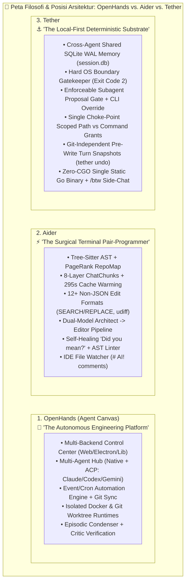

# Analisis Keunikan 3 Sistem: OpenHands vs. Aider vs. Tether

> **Dokumen**: Comparative Architectural Identity & Uniqueness Analysis  
> **Objek Analisis**:
> 1. **OpenHands (`OpenHands/OpenHands` v1.43.0)** — `/home/lenovo/crossparties/OpenHands`
> 2. **Aider (`Aider-AI/aider`)** — `/home/lenovo/crossparties/aider`
> 3. **Tether (`github.com/crossparties/tether` v0.2.0)** — `/home/lenovo/crossparties/tether`
> **Metodologi**: Eksplorasi AST, Complexity, dan Simbol Lintas-Repositori via MCP (`tree-sitter` & `serena`)

Dokumen ini menganalisis **identitas arsitektural, keunikan eksklusif (*The Moat*), dan keunggulan komparatif** dari ketiga proyek di workspace Anda. Ketiganya tidak saling menggantikan secara identik, melainkan mewakili **3 lapisan dan filosofi berbeda** dalam ekosistem rekayasa perangkat lunak berbasis AI.

---

## 1. Peta Posisi Paradigma Ketiga Sistem

| Dimensi Identitas | **OpenHands (Agent Canvas)** | **Aider** | **Tether** |
| :--- | :--- | :--- | :--- |
| **Kategori Produk** | *Self-Hosted Developer Control Center & Automation Platform* | *AI Pair Programming CLI in Terminal* | *Local-First Deterministic Memory & Safety Substrate (+ Micro-Harness)* |
| **Metafora Utama** | **"Mission Control & Tim Engineer Otonom 24/7"** | **"Senior Pair-Programmer Bedah Kode di Terminal"** | **"Jangkar Memori & Sabuk Pengaman Lintas-Agen"** |
| **Stack & Distribusi** | React 19 + TypeScript (Frontend/Electron/Lib) + Python SDK/Server + Docker | Python CLI + Tree-Sitter + NetworkX + LiteLLM + Git | **Pure Go (`CGO_ENABLED=0`) Single Static Binary** + Embedded SQLite WAL (`modernc.org/sqlite`) |
| **Fokus Masalah Utama** | Bagaimana menjalankan, memantau, dan mengotomasi banyak agen di local/Docker/cloud secara terpusat? | Bagaimana mengedit kode di repositori besar secara super cepat, akurat, dan hemat token/cache? | Bagaimana mencegah agen AI kehilangan memori antar-sesi/antar-tool dan mencegahnya merusak kode tanpa izin? |

---

## 2. Keunikan Eksklusif OpenHands (*Why OpenHands Stands Out*)

Berdasarkan analisis MCP pada **2.435 file TypeScript/TSX** di [`/home/lenovo/crossparties/OpenHands`](file:///home/lenovo/crossparties/OpenHands/README.md), OpenHands memiliki **7 keunikan arsitektural** yang tidak dimiliki Aider maupun Tether:

### 1. Multi-Agent Hub via ACP (*Agent-Client Protocol*)
* **Bukti Kode**: [`docs/ACP_AGENTS.md`](file:///home/lenovo/crossparties/OpenHands/docs/ACP_AGENTS.md) & [`src/constants/acp-providers.ts`](file:///home/lenovo/crossparties/OpenHands/src/constants/acp-providers.ts).
* **Keunikan**: OpenHands bukan hanya antarmuka untuk agen OpenHands sendiri; ia mampu menjadi *control center* untuk menjalankan **Claude Code, Codex, Gemini CLI, Pi, dan OpenCode** di dalam satu UI seragam.

### 2. Multi-Backend & Multi-Sandbox Orchestration
* **Bukti Kode**: [`src/api/backend-registry/`](file:///home/lenovo/crossparties/OpenHands/src/api/backend-registry/active-store.ts), [`F25-backends-and-cloud.md`](file:///home/lenovo/crossparties/OpenHands/.agents/skills/verify-openhands/references/feature-map/F25-backends-and-cloud.md), & [`F15.runtime-page`](file:///home/lenovo/crossparties/OpenHands/.agents/skills/verify-openhands/references/feature-map/F15-agent-behavior-settings.md#L42).
* **Keunikan**: Pengguna bisa menjalankan setiap percakapan di dalam **container Docker terisolasi (`OH_CONVERSATION_RUNTIME=docker`)** dengan batas CPU/RAM tersendiri, di dalam **Git Worktree otomatis per percakapan**, di VM remote, di DigitalOcean Managed Agents (`src/api/mars/`), atau di OpenHands Cloud—dan berpindah backend secara instan tanpa reload aplikasi.

### 3. Always-On Event & Cron Automation Engine + Encrypted Git Sync
* **Bukti Kode**: [`src/routes/automations-list.tsx`](file:///home/lenovo/crossparties/OpenHands/src/routes/automations-list.tsx) & [`src/routes/automation-git-sync.tsx`](file:///home/lenovo/crossparties/OpenHands/src/routes/automation-git-sync.tsx).
* **Keunikan**: Baik Aider maupun Tether bersifat *interactive-first* (menunggu developer mengetik di terminal). OpenHands memiliki **Automation Server** yang menjalankan agen di latar belakang berdasarkan jadwal Cron atau trigger webhook (Slack, GitHub, Linear) serta menyinkronkan konfigurasi otomasi secara terenkripsi ke repositori Git (**Automation Git Sync**).

### 4. Enterprise-Grade MCP Manager (OAuth 2.0 PKCE + Credential Probing + Sparse Patching)
* **Bukti Kode**: [`src/api/mcp-service/mcp-service.api.ts:227-437`](file:///home/lenovo/crossparties/OpenHands/src/api/mcp-service/mcp-service.api.ts#L227-L437) & [`src/utils/mcp-config.ts:318-377`](file:///home/lenovo/crossparties/OpenHands/src/utils/mcp-config.ts#L318-L377).
* **Keunikan**: Menyediakan katalog 56+ integrasi MCP (`@openhands/extensions`), mendukung `stdio`, `sse`, dan `shttp`, menangani alur pop-up **OAuth 2.0 Dynamic Client Registration** secara otomatis, memverifikasi token dengan *read-only tool call probe*, menyinkronkan kredensial ke **Secrets**, dan melindungi token dengan *redacted sparse patching* (`**********`).

### 5. Meta-LLM Model Router & Iterative Critic Verification
* **Bukti Kode**: [`F12-model-router.md`](file:///home/lenovo/crossparties/OpenHands/.agents/skills/verify-openhands/references/feature-map/F12-model-router.md) & [`F15.verification-critic-fields`](file:///home/lenovo/crossparties/OpenHands/.agents/skills/verify-openhands/references/feature-map/F15-agent-behavior-settings.md#L39).
* **Keunikan**: Memiliki `route_task_to_model` yang menggunakan model classifier untuk memilih model paling pas pada pesan pertama, serta **Critic Model** yang memberi skor probabilitas keberhasilan (`Score: N.N%`) dan memicu *Iterative Refinement* otomatis jika hasil kerja agen di bawah `critic_threshold`.

### 6. Durable Event Stream, Conversation Branching & Embeddable Library
* **Bukti Kode**: [`F06.branch-from-here`](file:///home/lenovo/crossparties/OpenHands/.agents/skills/verify-openhands/references/feature-map/F06-agent-activity.md#L53) & [`package.json:233-276`](file:///home/lenovo/crossparties/OpenHands/package.json#L233-L276).
* **Keunikan**: Setiap pesan di tengah percakapan dapat di-*fork* menjadi cabang percakapan baru (`Branch from here`), seluruh panel (Terminal xterm, Browser screenshot, Monaco Diff Viewer, Planner `PLAN.md`, Task List, Usage Meter) terintegrasi secara visual, dan komponen UI-nya dapat di-embed sebagai library npm ke aplikasi host lain.

---

## 3. Keunikan Eksklusif Aider (*Why Aider Stands Out*)

Berdasarkan analisis MCP pada **147 file Python** di [`/home/lenovo/crossparties/aider`](file:///home/lenovo/crossparties/aider/README.md), Aider memiliki **7 keunikan rekayasa algoritma** yang membuatnya sangat cepat dan akurat dalam mengedit kode:

### 1. Graph-Ranked `RepoMap` (Tree-Sitter AST + NetworkX PageRank)
* **Bukti Kode**: [`aider/repomap.py:279-575`](file:///home/lenovo/crossparties/aider/aider/repomap.py#L279-L575).
* **Keunikan**: Aider tidak menggunakan pencarian keyword/FTS5 biasa. Ia mem-parse seluruh repositori dengan kueri Tree-Sitter (`.scm` untuk 100+ bahasa) guna memetakan **siapa mendefinisikan simbol $X$ (`def`)** dan **siapa memanggil simbol $X$ (`ref`)**. Di atas graf dependensi simbol tersebut, Aider menjalankan algoritma **PageRank** dengan bobot personalisasi terhadap identifier yang disebut user, lalu merender *signature* kelas/fungsi terpenting menggunakan `TreeContext` dalam anggaran token yang presisi (`1024` token).

### 2. 8-Layer Stratified `ChatChunks` + Tail Reminder + 295s Cache Warming Thread
* **Bukti Kode**: [`aider/coders/chat_chunks.py:6-64`](file:///home/lenovo/crossparties/aider/aider/coders/chat_chunks.py#L6-L64) & [`aider/coders/base_coder.py:1226-1394`](file:///home/lenovo/crossparties/aider/aider/coders/base_coder.py#L1226-L1394).
* **Keunikan**: Menyusun struktur pesan menjadi 8 lapisan ketat dari statis ke dinamis (`system` $\rightarrow$ `examples` $\rightarrow$ `readonly_files` $\rightarrow$ `repo` $\rightarrow$ `done` $\rightarrow$ `chat_files` $\rightarrow$ `cur` $\rightarrow$ `reminder`), meletakkan pengingat format di **ekor**, menaruh 3 `cache_control` breakpoints, dan menjaga cache tetap hidup di server provider dengan thread ping latar belakang setiap 295 detik.

### 3. 12+ Format Edit Non-JSON yang Disesuaikan per Model + Fuzzy Patching
* **Bukti Kode**: [`aider/coders/editblock_coder.py:15-240`](file:///home/lenovo/crossparties/aider/aider/coders/editblock_coder.py#L15-L240) & [`aider/coders/search_replace.py:18-327`](file:///home/lenovo/crossparties/aider/aider/coders/search_replace.py#L18-L327).
* **Keunikan**: Aider menyadari bahwa memaksa LLM menulis kode ratusan baris di dalam argumen string JSON (`tool_calls`) sering merusak escaping kutip/newline dan boros token. Aider menyediakan >12 coder khusus (`editblock` `SEARCH/REPLACE`, `udiff`, `wholefile`, `patch`, `editor_diff_fenced`) lengkap dengan pencocokan elipsis `...` (`try_dotdotdots`), `RelativeIndenter` (`←`), dan Google `diff_match_patch`.

### 4. Dual-Model `ArchitectCoder` (*Architect Brain* $\rightarrow$ *Editor Hands*)
* **Bukti Kode**: [`aider/coders/architect_coder.py:6-48`](file:///home/lenovo/crossparties/aider/aider/coders/architect_coder.py#L6-L48).
* **Keunikan**: Mengawinkan dua model berbeda dalam satu turn: model penalaran berat (`main_model`, mis. `deepseek-reasoner` / `o1`) merancang solusi tanpa beban format diff, lalu model editor cepat (`editor_model`, mis. `deepseek-chat` / `sonnet`) dengan `map_tokens=0` dan `done_messages=[]` langsung mengeksekusi perubahan ke file.

### 5. Self-Healing Reflection Loop: `"Did you mean?"` + Universal Tree-Sitter AST Linter
* **Bukti Kode**: [`aider/coders/editblock_coder.py:84-124`](file:///home/lenovo/crossparties/aider/aider/coders/editblock_coder.py#L84-L124) & [`aider/linter.py:82-270`](file:///home/lenovo/crossparties/aider/aider/linter.py#L82-L270).
* **Keunikan**:
  * Saat blok `SEARCH` gagal cocok, Aider mencari baris paling mirip di file dengan `SequenceMatcher` dan langsung menyodorkannya ke model (*"Did you mean to match some of these actual lines?"*).
  * Setelah setiap edit, `basic_lint` mem-parse AST Tree-Sitter file tersebut untuk mendeteksi node syntax `ERROR` / `is_missing` pada 100+ bahasa, menandai baris error dengan `█` di dalam `TreeContext`, dan memicu loop refleksi otomatis (`max_reflections = 3`).

### 6. IDE File Watcher (`# AI!` / `// AI?` Comments)
* **Bukti Kode**: [`aider/watch.py:65-318`](file:///home/lenovo/crossparties/aider/aider/watch.py#L65-L120).
* **Keunikan**: Memungkinkan developer tetap bekerja di editor apa pun (Vim, Emacs, VS Code, JetBrains). Cukup ketik komentar `# AI! tambahkan validasi input` di dalam file sumber dan simpan; `FileWatcher` Aider mendeteksi regex komentar `AI!` / `AI?`, membaca konteks AST file tersebut, dan langsung menerapkan kodenya.

### 7. Dirty-Commit Git Hygiene & Infinite Output Prefill (`FinishReasonLength`)
* **Bukti Kode**: [`aider/coders/base_coder.py:1492-1505, 2175-2400`](file:///home/lenovo/crossparties/aider/aider/coders/base_coder.py#L1492-L1505).
* **Keunikan**: Otomatis memisahkan commit perubahan manual manusia (`dirty_commit`) sebelum melakukan commit perubahan AI, serta menyambung output panjang yang terpotong `max_tokens` menggunakan *Assistant Prefill* (`prefix=True`).

---

## 4. Keunikan Eksklusif Tether (*Why Tether Stands Out*)

Berdasarkan analisis MCP pada **86 file Go** di [`/home/lenovo/crossparties/tether`](file:///home/lenovo/crossparties/tether/README.md), Tether memiliki **7 keunikan fundamental sebagai *Deterministic Substrate & Gatekeeper*** yang tidak dimiliki oleh OpenHands maupun Aider:

### 1. Cross-Agent Shared Subconscious Substrate (`session.db` SQLite WAL)
* **Bukti Kode**: [`internal/core/engine.go:65-260`](file:///home/lenovo/crossparties/tether/internal/core/engine.go#L65-L260) & [`internal/adapter/adapter.go`](file:///home/lenovo/crossparties/tether/internal/adapter/adapter.go).
* **Keunikan**: OpenHands dan Aider menyimpan histori mereka untuk ekosistem mereka sendiri. **Tether adalah satu-satunya lapisan infrastruktur netral (*vendor-neutral substrate*)** yang menyatukan memori lintas agen: Anda dapat melakukan perencanaan di **Antigravity (`agy`)**, pindah ke **Claude Code**, mengedit di **Cursor / Windsurf / Cline / Roo / Codex**, atau memakai **`tether tui`**—dan semuanya terhubung ke database relasional SQLite WAL (`session.db`) yang sama, mewarisi *Decisions*, *Learned Patterns (`do`/`avoid`)*, *Project Settings*, dan *Todos* secara instan (`<2ms`).

### 2. Hard OS Process Boundary Enforcement (`Exit Code 2`)
* **Bukti Kode**: [`cmd/tether/main.go:145-176`](file:///home/lenovo/crossparties/tether/cmd/tether/main.go#L145-L176) & [`internal/hooks/handler.go:335-515`](file:///home/lenovo/crossparties/tether/internal/hooks/handler.go#L335-L515).
* **Keunikan**: Saat repositori dikunci ke `tether mode plan`, Tether tidak sekadar meminta model lewat prompt untuk "jangan mengedit kode". Tether menghadang di level proses sistem operasi melalui hook `PreToolUse` dan mengeluarkan **`os.Exit(2)`** untuk menggagalkan secara fisik setiap percobaan penulisan file di luar `docs/**` dan `.agents/**` (dilengkapi resolusi `filepath.EvalSymlinks` untuk mencegah *symlink escape*).

### 3. Enforceable Subagent Proposal Gate + Out-of-Band Human CLI (`tether proposal`)
* **Bukti Kode**: [`internal/hooks/handler.go:355-439`](file:///home/lenovo/crossparties/tether/internal/hooks/handler.go#L355-L439) & [`cmd/tether/main.go:180-360`](file:///home/lenovo/crossparties/tether/cmd/tether/main.go#L180-L360).
* **Keunikan**:
  * Selama ada proposal dari subagent yang berstatus `pending` di tabel `subagent_proposals`, **Main Agent sendiri ikut dikunci secara fisik oleh Proposal Gate** dari menulis file, mengubah todo/decision, atau menjalankan SQL/shell mutatif.
  * Lebih kuat lagi, perintah CLI `tether proposal approve|reject|abandon` menulis keputusan manusia **langsung ke `session.db` tanpa melewati LLM sama sekali**, sehingga agen yang nakal atau berhalusinasi tidak mungkin memalsukan persetujuan.

### 4. Deny-by-Default Subagent Allowlist dengan MCP Wrapper Unwrapping
* **Bukti Kode**: [`internal/hooks/subagent_access.go:114-160`](file:///home/lenovo/crossparties/tether/internal/hooks/subagent_access.go#L114-L160) & [`internal/harness/subagent.go:129-144`](file:///home/lenovo/crossparties/tether/internal/harness/subagent.go#L129-L144).
* **Keunikan**: Membuka bungkus tool generik (`subagentUnwrapMCP` pada `call_mcp_tool`), memecah rantai perintah shell (`splitCommandSegments` agar `go test ./... && git commit` tidak lolos), mengizinkan perintah pembuktian (`go test`, `go build`, `go vet`, `git diff/status/log/show`), dan menolak mutlak mutasi file maupun `git add/commit/reset/checkout/stash` oleh subagent.

### 5. Single Choke-Point MCP Approval Gate & Smart Scoped Grants
* **Bukti Kode**: [`internal/mcp/server.go:615-626`](file:///home/lenovo/crossparties/tether/internal/mcp/server.go#L615-L626), [`internal/mcp/approval.go:129-191`](file:///home/lenovo/crossparties/tether/internal/mcp/approval.go#L129-L191), & [`internal/core/grants.go`](file:///home/lenovo/crossparties/tether/internal/core/grants.go).
* **Keunikan**: Memasang gerbang persetujuan pada satu titik cekik tunggal (`Server.CallTool` $\rightarrow$ `requireApproval`) yang memisahkan **Path Grants** (izin tulis per folder) dari **Command Prefix Grants** (ekspansi prefix cerdas 2 kata untuk `git`/`go`/`npm`/`docker` vs 1 kata untuk `echo`/`cat`) dengan TTL otomatis 60 menit.

### 6. Git-Independent Pre-Write Turn Snapshots (`.tether/snapshots/`)
* **Bukti Kode**: [`internal/snapshot/snapshot.go`](file:///home/lenovo/crossparties/tether/internal/snapshot/snapshot.go) & [`cmd/tether/main.go:464-527`](file:///home/lenovo/crossparties/tether/cmd/tether/main.go#L464-L527).
* **Keunikan**: Berbeda dengan Aider yang mengandalkan `git commit` otomatis untuk `/undo` (yang dapat mengotori `git log` dengan banyak commit kecil), Tether mem-backup file asli tepat sebelum ditulis ke dalam `.tether/snapshots/<turn_id>/`. Hasilnya, `tether undo` dapat mengembalikan perubahan per-turn secara instan **tanpa menyentuh atau mengotori histori Git sama sekali**!

### 7. Zero-CGO Single Static Go Binary + Sub-0.1ms `.git/HEAD` Sniffer + Custom Termios TUI
* **Bukti Kode**: [`go.mod`](file:///home/lenovo/crossparties/tether/go.mod), [`internal/core/engine.go:39-57`](file:///home/lenovo/crossparties/tether/internal/core/engine.go#L39-L57), [`internal/tui/`](file:///home/lenovo/crossparties/tether/internal/tui/model.go), & [`internal/harness/btw.go`](file:///home/lenovo/crossparties/tether/internal/harness/btw.go).
* **Keunikan**: Tidak membutuhkan instalasi Python, Node.js, maupun Docker. Satu binary statis Go (~16 MB) sudah mencakup SQLite WAL + FTS5 BM25, MCP Server 31 tool, Lifecycle Hook Engine, pembaca `.git/HEAD` langsung dari memori (`<0.1ms` tanpa spawn proses `git`), TUI murni berbasis syscall `termios`, serta fitur `/btw` (*ephemeral side-chat*) yang terisolasi 100% dari histori percakapan utama.

---

## 5. Kesimpulan Strategis: Formula "The Ultimate Tether"

Dari perbandingan keunikan ketiga sistem di atas, terlihat jelas bahwa **Tether memiliki fondasi Substrat & Keamanan (Governance/Moat) yang tidak dimiliki oleh Aider maupun OpenHands**:

$$\text{Visi Tether Selanjutnya} = \underbrace{\text{Substrat & Guardrail Deterministik Tether}}_{\text{SQLite WAL + Exit Code 2 + Proposal Gate + Snapshots}} + \underbrace{\text{Mesin Harness CLI Aider}}_{\text{ChatChunks + RepoMap + Architect/Editor + DidYouMean}} + \underbrace{\text{Ketahanan Runtime OpenHands}}_{\text{Episodic Condenser + Stuck Detection + External MCP Client}}$$

1. **Jangan mengubah identitas Tether sebagai Substrat Lokal Zero-CGO (`session.db` + Hooks + MCP Gatekeeper)**: Itu adalah keunikan mutlak Tether yang menyatukan seluruh agen (`agy`, Claude Code, Cursor, Codex).
2. **Adopsi kecerdasan Harness CLI dari Aider**: Gunakan struktur prompt berlapis **`ChatChunks` + Tail Reminder**, dual-model **`Architect -> Editor`**, refleksi **`"Did you mean?"`** saat `edit_file` meleset, dan **`RepoMap`** berbasis AST untuk membuat `internal/harness` Tether secepat dan seakurat Aider.
3. **Adopsi ketahanan sesi dari OpenHands**: Gunakan **Episodic Condenser (High/Low-Water Mark)**, **Incremental History Persistence** (agar `Ctrl+C` tidak menyebabkan amnesia), **Retry Backoff + Idle Stream Watchdog**, serta **External MCP Client Bridge** agar Tether menjadi ekosistem agen lokal yang paling lengkap dan tangguh.
