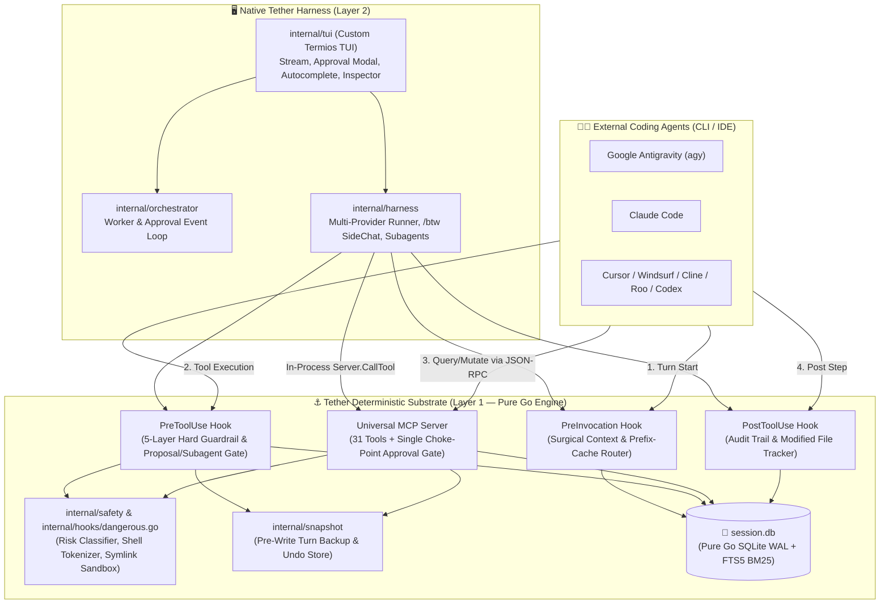

# Tether Architecture & Technical Specification (v0.2.0)

> **Repository**: `github.com/crossparties/tether`  
> **Role**: Local-First Deterministic Memory & Safety Substrate + Interactive AI Agent Harness

This document details the internal design, dual-layer runtime mechanics, storage schema, lifecycle interception pipeline, and governance protocols of **Tether**.

---

## 1. Dual-Layer System Architecture

Tether operates simultaneously as:
1. **Layer 1 — Universal Deterministic Substrate & Gatekeeper**: Connects to external coding agents (Google Antigravity `agy`, Anthropic Claude Code, Cursor, Windsurf, Cline, Roo, Codex, OpenCode) via **OS Lifecycle Hooks** (`tether hook`) and **Universal Stdio MCP Server** (`tether mcp`).
2. **Layer 2 — Native Interactive Agent Harness & TUI**: Provides a built-in, zero-dependency terminal UI (`tether` / `tether tui`) and REPL (`tether chat` / `tether run`) supporting OpenAI-compatible providers (`deepseek`, `openrouter`, `openai`, `groq`, `gemini`, `xai`, `ollama`).

---

## 2. Package Map (`cmd/` & `internal/`)

| Package | Primary Files | Responsibility |
| :--- | :--- | :--- |
| `cmd/tether` | `main.go` | CLI entry point, command dispatcher, and `tui.AgentBridge` wiring. |
| `internal/core` | `engine.go`, `grants.go`, `handoff.go`, `workspace.go` | SQLite WAL engine, schema v2 fast-path migration, sessions, proposals, approval grants, FTS5 BM25 search, and structured subagent handoff parser. |
| `internal/mcp` | `server.go`, `approval.go` | Newline-delimited JSON-RPC 2.0 stdio server, 31 tools, single choke-point approval gate (`requireApproval`), fuzzy file editing, and automatic `go vet`. |
| `internal/hooks` | `handler.go`, `dangerous.go`, `subagent_access.go` | Lifecycle hook handlers (`PreInvocation`, `PreToolUse`, `PostToolUse`), shell danger classifier, proposal gate, and deny-by-default subagent allowlist. |
| `internal/safety` | `policy.go`, `shell.go` | Risk classification (`RiskLow` vs `RiskHigh`), read-only/validation command recognition, symlink-safe workspace boundary checks, and `IsNonCriticalTool` defense-in-depth policy. |
| `internal/snapshot` | `snapshot.go` | Pre-write file snapshot capture and per-turn restoration (`.tether/snapshots/<turn>/`) powering `tether undo` without Git. |
| `internal/preview` | `preview.go` | Colored unified diff generator for approval previews. |
| `internal/harness` | `runner.go`, `commands.go`, `subagent.go`, `subagent_run.go`, `btw.go`, `stream.go`, `approval_prompt.go` | OpenAI-compatible tool-calling loop, SSE streaming, centralized slash-command registry, isolated `/btw` side-chat, turn-aware context compaction, and subagent execution. |
| `internal/orchestrator` | `engine.go`, `worker.go`, `registry.go` | Goroutine worker pool, subagent lifecycle events, and approval synchronization channels. |
| `internal/tui` | `model.go`, `update.go`, `view.go`, `program.go`, `subagents.go`, `views/*` | Full-screen terminal UI with approval modal, `/` and `@file` autocomplete dropdown, inspector modal, and subagent activity monitor. |
| `internal/ui` | `ui.go`, `picker.go`, `spinner.go`, `termios_*.go` | ANSI styling, Unicode/CJK width computation, interactive terminal picker, spinner, and cross-platform raw-mode `termios`. |
| `internal/adapter` | `adapter.go` | Automated agent configuration wiring (`tether install`) for `agy`, `claude`, `codex`, `cursor`, `windsurf`, `cline`, `roo`, `opencode`, and `all`. |

---

## 3. Storage Substrate (`session.db`)

Tether uses an embedded, pure-Go SQLite database (`session.db`) at the repository root:

- **Storage Engine**: `modernc.org/sqlite` (Zero CGO dependency, cross-platform static binary).
- **Concurrency & WAL Mode**: `PRAGMA journal_mode=WAL; PRAGMA busy_timeout=5000; PRAGMA synchronous=NORMAL;`
- **Memory Optimization**: `cache_size=-10000` (10MB), `temp_store=MEMORY`, and `mmap_size=67108864` (64MB).
- **Fast-Path Migration**: Schema versioning via `PRAGMA user_version = 2` and `missingTables()` verification ensures subsequent hook invocations bypass DDL overhead, keeping hook latency under `~70ms`.
- **9 Core Tables + FTS5 Virtual Table**:
  1. `sessions` (`id`, `workspace`, `branch`, `mode`, `summary`, `status`, `created_at`, `updated_at`)
  2. `session_context` (`id`, `session_id`, `agent`, `role`, `content`, `created_at`)
  3. `project_settings` (`workspace`, `key`, `value`)
  4. `decisions` (`id`, `workspace`, `session_id`, `topic`, `decision`, `reason`, `created_at`)
  5. `learned_patterns` (`id`, `workspace`, `type` [`do`|`avoid`], `description`, `created_at`)
  6. `todos` (`id`, `workspace`, `branch`, `session_id`, `description`, `status`, `created_at`, `completed_at`)
  7. `kb_documents` + `kb_fts` (FTS5 BM25 full-text index over `filepath` and `content`)
  8. `subagent_proposals` (`id`, `workspace`, `session_id`, `role`, `proposal`, `status` [`pending`|`approved`|`rejected`|`abandoned`], `comment`, `created_at`, `resolved_at`)
  9. `approval_grants` (`workspace`, `scope`, `expires_at`)

---

## 4. Lifecycle Interception Pipeline (`tether hook`)

### 4.1 `PreInvocation`
- Fires before model inference begins.
- **Main Conversation Identity Guard**: Records `main_conversation_id` only when `!input.IsSubagent`, preventing background subagents from hijacking main-agent permissions.
- **Prefix-Cache Optimization (DeepSeek 64-Token Block Stability)**: Places static protocol rules and alphabetically sorted `project_settings` (excluding volatile `current_turn`) at the top of the injected prompt, and dynamic context (newest 5 decisions, newest 5 patterns capped at 300 runes, pending todos, last 6 non-tool context entries, and `ClassifyTask` router hint) at the bottom.
- **16KB Anti-Pipe Deadlock Guard**: Truncates output at `16,384` bytes to prevent POSIX pipe buffer deadlocks.

### 4.2 `PreToolUse` (5-Layer Deterministic Gatekeeper)
Evaluates intended tool actions before execution and exits with **OS Exit Code 2** on denial:
1. **Catastrophic & DB-Hack Protection**: Blocks destructive shell commands (`rm -rf /`, `mkfs`, `dd`, `shred`, recursive system `chmod`/`chown`, nested `eval`/`sh -c`/`find -exec`/`xargs`/`awk system()`) and blocks direct `sqlite3`/python shell access to `session.db` (redirecting agents to in-process MCP tools).
2. **Pending Proposal Gate**: If a subagent proposal is awaiting user approval (`status = 'pending'`), the Main Agent is blocked from executing file writes, state-mutating tools (`session_save`, `todo_*`, `decision_add`, `pattern_add`, `setting_set`), mutative `sql_query`, or mutative shell commands until `approve_proposal` or `reject_proposal` is called (or resolved via `tether proposal` CLI).
3. **Subagent Allowlist Gate (`checkSubagentAccess`)**: Unwraps MCP wrapper tools (`call_mcp_tool`) first, then enforces a strict deny-by-default allowlist. Subagents may only execute read tools, read-only `sql_query`, evidence commands (`git diff`, `git status`, `git log`, `git show`), and validation commands (`go test`, `go build`, `go vet`). File writes and `git add/commit/reset/checkout/stash` are unconditionally denied.
4. **Plan Mode Gate**: When mode is `plan`, file writes outside `docs/**`, `.agents/**`, or `*.plan.md` (verified after symlink resolution via `filepath.EvalSymlinks`) and mutative shell commands are rejected with Exit Code 2.
5. **Pre-Write Snapshot Capture**: Automatically backs up target files to `.tether/snapshots/<turn>/` before allowing a write.

### 4.3 `PostToolUse`
- Tracks modified files in real-time and records audit trails to `session_context`.

---

## 5. Subagent Governance & Structured Handoff Protocol

1. **Closed Role Set**: Subagents run under validated roles (`tether_planner`, `tether_coder`, `tether_reviewer`, `tether_qa`, `tether_researcher`, `worker`) with bounded depth (`MaxSubagentDepth = 1`), steps (`SubagentMaxSteps = 12`), and timeout (`SubagentTimeout = 3m`).
2. **Structured Handoff Verification (`core.ParseHandoff`)**: Subagent outputs are parsed for structured `STATUS` (`READY_FOR_REVIEW | BLOCKED | NEEDS_CONTEXT`) or `VERDICT` (`APPROVED | REJECTED` with mandatory `REMEDIATION`). Missing or ambiguous prose triggers a single re-dispatch before failing closed.
3. **Out-of-Band User Control (`tether proposal`)**: Users can inspect, approve, reject (with `-m "steering"` or `--topic`), or abandon proposals directly from the CLI without going through the LLM.

---

## 6. Universal MCP Server Specification (31 Tools)

Tether provides a standard newline-delimited JSON-RPC 2.0 stdio server (`tether mcp`) with a **single choke-point approval gate** inside `Server.CallTool`:

| Category | Tool Name | Gate / Mode | Description |
| :--- | :--- | :--- | :--- |
| **Workspace & Session** | `workspace_info` | Read-Only | Inspect active workspace path, session ID, Git branch, and governance mode |
| | `session_load` | Read-Only | Load active session summary, project settings, decisions, patterns, and recent context |
| | `session_save` | Substrate Write | Save an updated summary of the current session |
| | `session_done` | Substrate Write | Mark the active session as completed |
| | `setting_set` | Substrate Write | Persist a project-level setting or convention |
| **Governance & Mode** | `mode_get` | Read-Only | Get current governance mode (`plan`, `code`, `review`) |
| | `mode_set` | Substrate Write | Switch governance mode (`plan`, `code`, `review`) |
| | `task_classify` | Read-Only | Classify a task prompt into recommended governance mode |
| | `subagent_spawn_rules` | Read-Only | Retrieve mandatory worker-orchestrator guidelines before spawning subagents |
| **Subagent Proposals** | `proposal_status` | Read-Only | Check pending subagent proposals blocking workspace mutations |
| | `approve_proposal` | Gate Exit | Approve pending subagent proposal(s) after user confirmation |
| | `reject_proposal` | Gate Exit | Reject pending subagent proposal(s) with optional steering feedback |
| **Approval & Grants** | `approve_change` | Gate Action | Authorize a pending file or command mutation (`once`, `path`/prefix, or `all`) |
| | `reject_change` | Gate Action | Reject a pending file or command mutation |
| | `list_grants` | Read-Only | List active path-scoped and command-prefix approval grants with remaining TTL |
| | `revoke_grants` | Gate Action | Revoke all active approval grants for the workspace |
| **Architectural Memory** | `decision_add` | Substrate Write | Record an architectural decision and rationale |
| | `pattern_add` | Substrate Write | Record a learned coding pattern (`do` or `avoid`) |
| | `sql_query` | Gated if Mutative | Execute read/write SQL queries against `session.db` |
| | `files_modified` | Read-Only | Retrieve audit list of files changed in the current session |
| **Knowledge Base (FTS5)** | `kb_index` | Substrate Write | Index a file or directory into the FTS5 BM25 knowledge base |
| | `kb_search` | Read-Only | Search the indexed knowledge base using FTS5 BM25 ranking |
| | `kb_status` | Read-Only | Return total indexed files and FTS5 chunk counts |
| **Tasks & Todos** | `todo_add` | Substrate Write | Add a new task item to the current session/branch |
| | `todo_list` | Read-Only | List pending (or all) tasks for the current session/branch |
| | `todo_complete` | Substrate Write | Mark a task as completed with optimistic locking |
| | `todo_remove` | Substrate Write | Delete a task item by ID |
| **Workspace Files & Shell** | `read_file` | Read-Only | Read file contents within workspace boundaries (supports line ranges) |
| | `write_file` | **Approval Gated** | Create/overwrite a file (with pre-write snapshot, plan gate, and auto `go vet`) |
| | `edit_file` | **Approval Gated** | Replace text in a file (with fuzzy whitespace matching, snapshot, and auto `go vet`) |
| | `run_command` | **Approval Gated** | Execute a shell command within workspace (with danger check and command grants) |
