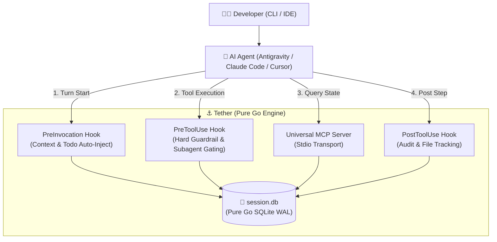

# Tether Architecture & Technical Specification

This document details the internal design, runtime mechanics, and governance protocols of **Tether**.

---

## 1. System Architecture

---

## 2. Storage Substrate

Tether uses an embedded, pure Go SQLite database (`session.db`) at the repository root.

- **Storage Engine**: `modernc.org/sqlite` (Zero CGO dependency, cross-platform static binary).
- **Concurrency & WAL Mode**: `PRAGMA journal_mode=WAL; PRAGMA busy_timeout=5000; PRAGMA synchronous=NORMAL;`
- **Memory Optimization**: `cache_size=-10000` (10MB), `temp_store=MEMORY`, and `mmap_size=64MB`.
- **Fast-Path Migration**: Schema versioning via `PRAGMA user_version = 2` ensures that subsequent invocations bypass redundant DDL overhead, keeping hook latency under `~70ms`.

---

## 3. Lifecycle Interception Pipeline

Tether taps into agent lifecycles via standardized hooks:

### `PreInvocation`
- Fires before model inference begins.
- Injects workspace context, session summary, pending tasks, recent decisions, and the last 5 context entries directly into the system prompt.
- Prevents agents from querying databases or running shell commands merely to figure out project state.

### `PreToolUse`
- Evaluates intended tool actions before execution.
- **Plan Mode Gating**: If the repository is in `plan` mode, mutations outside `docs/` and `.agents/` are intercepted and rejected with process exit code 2.
- **Catastrophic Protection**: Destructive commands (`rm -rf /`, `mkfs`) are unconditionally blocked.
- **Direct Shell Interception**: Attempts to execute raw bash `sqlite3` or python scripts against `session.db` are redirected to Tether's pre-approved MCP tools.

### `PostToolUse`
- Tracks modified files in real-time.
- Records audit trails and tool usage metrics to `session_context`.

---

## 4. Subagent Governance Protocol

When agents spawn subagents (background workers):
1. **Worker Role**: Subagents are restricted to analysis, research, and diff generation.
2. **No Direct Mutation**: Subagents cannot write to files or run destructive shell operations directly.
3. **Interactive Main Gate**: Proposed patches are returned to the Main Agent. The Main Agent presents the proposal to the user in the interactive session for human approval, preventing headless terminal hangs.

---

## 5. Universal MCP Server Specification

Tether provides a standard newline-delimited JSON-RPC 2.0 stdio server (`tether mcp`):

| Category | Tool | Description |
| :--- | :--- | :--- |
| **Session** | `workspace_info` | Inspect active project workspace, session ID, branch, and governance mode |
| | `session_load` | Load active or specific session context, settings, and decisions |
| | `session_save` | Save an updated summary of the current session |
| | `session_done` | Mark the active session as completed |
| **Governance** | `mode_get` | Get current governance mode (`plan`, `code`, `review`) |
| | `mode_set` | Switch governance mode |
| | `subagent_spawn_rules` | Retrieve mandatory worker-orchestrator guidelines |
| **Tasks & Todos** | `todo_list` | List pending and completed tasks for current session/branch |
| | `todo_add` | Add a new task item with description |
| | `todo_complete` | Mark a task as completed with optimistic locking |
| | `todo_remove` | Delete a task item |
| **Memory & SQL** | `sql_query` | Execute read/write queries safely against `session.db` |
| | `decision_add` | Record an architectural decision and rationale |
| | `pattern_add` | Record a learned coding pattern (`do` or `avoid`) |
| | `setting_set` | Persist a project-level setting or convention |
| | `files_modified` | Retrieve audit list of files changed in current session |
